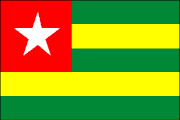
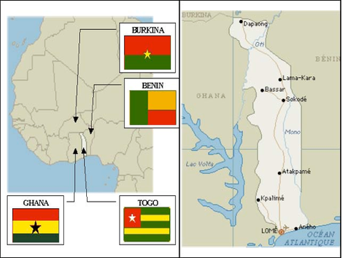
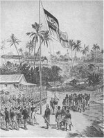
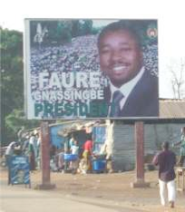

<figure class="gallery-item">
    
    <figcaption>Drapeau du Togo</figcaption>
  </figure>

Le Togo se trouve en Afrique de l'Ouest, entre le Ghana à l'ouest, le Bénin à l'est, le Burkina au nord et sur le golfe de Guinée au sud (cf photo 1). Sa superficie est de 56'600 km2, pour environ 700 km de long et 50 à 150 km de large. En 2012, on y recense plus de 6'900'000 habitants. La langue officielle est le français. En plus du français, l'éwé et le kabyè sont enseignés dans le pays (parmi une quarantaine de langues). Par comparaison, la Suisse a une superficie de 41'293 km2 et une population d'un peu plus de 8'000'000 d'habitants (2012). La monnaie du pays est le franc CFA (Taux approximatif 1 CHF = 500 CFA).

<figure class="gallery-item">
    
    <figcaption>Carte du Togo en Afrique de l’Ouest</figcaption>
  </figure>

C'est un pays au climat tropical humide au sud (forêts) et de plus en plus sec en allant au nord (savanes). Le Togo demeure essentiellement rural. Les exportations de produits agricoles (palmistes, café, cacao, coton) viennent cependant loin derrière celles des phosphates, seule ressource notable du sous-sol. Le Togo est d’ailleurs le cinquième producteur mondial de phosphates.

La base de l'alimentation des habitants du pays est constituée de manioc, de maïs, de mil et d'igname. L'espérance de vie à la naissance est de 63 ans (2012). Le PIB 2011 par habitant est de 900 $.

La capitale, Lomé, se trouve au sud du pays en bord de mer et a vu de ce fait s'y développer un important port, seul port en eau profonde de la sous-région, doté d'une zone franche. Elle concentre une grande partie de la population (environ 800'000 habitants en 2010) et est le centre économique et politique du pays. Elle possède un aéroport international, connecté avec les principales capitales du monde. Une particularité à relever : un bon quart de la ville se trouve au Ghana !

Depuis 2012 la population a connu une croissance soutenue et dépasse désormais les 9 millions d'habitants (2024-2026). Le pays continue de diversifier son économie, notamment à travers la "Feuille de route gouvernementale 2020-2025", qui vise à transformer le Togo en un hub logistique et financier majeur en Afrique de l'Ouest. Le Port Autonome de Lomé reste un moteur économique essentiel, renforçant sa position de leader dans la sous-région. Le PIB par habitant a progressé, porté par les investissements dans les infrastructures et la digitalisation des services publics. Le taux de change reste stable autour de 1 CHF ≈ 710 CFA (2026).

Plus de statistiques : [Statistiques mondiales, fiche Togo](https://www.statistiques-mondiales.com/togo.htm)

Site officiel du Togo : [Republic of Togo](https://www.republicoftogo.com/)

Voir aussi : [Lomé](https://fr.wikipedia.org/wiki/Lomé)

<figure class="gallery-item">
    
    <figcaption>Cérémonie de lever du drapeau</figcaption>
  </figure>

# Histoire

Sources: [wikipédia](https://wikipedia/)

Dès le **XIème siècle**: présence humaine attestée par la découverte de divers objets.

**XV-XVIèmes siècles**: la côte est visitée par les Portugais, puis par les Danois. Des missionnaires portugais arrivent, mais un protectorat de fait est exercé par le Danemark. Le commerce des esclaves y est prospère.

**Seconde moitié du** **XIXème siècle**: Le commerce des esclaves est remplacé par le commerce d'huile de palme.

**1884**: l'explorateur Nachtigal établit le protectorat allemand sur le pays, auquel il donne son nom actuel.

**1897**: la capitale est établie à Lomé.

**1914**: les Alliés conquièrent aisément le protectorat.

**1919**: le Togo est partagé entre la France (qui obtient la côte de Lomé) et la Grande-Bretagne (qui obtient les terres de l'Ouest).

**1922**: le partage est confirmé par l'octroi de mandats de la SDN.

<figure class="gallery-item">
    
    <figcaption>Panneau électoral de Faure Gnassingbé</figcaption>
  </figure>

**1946:** Le pays passe sous la tutelle de l'ONU.

**1956-1957:** Le nord du Togo britannique est rattaché à la Côte-d'Or, qui devient l'État indépendant du Ghana. Le reste du pays forme une république autonome.

**1960:** Cette république devient indépendante. Sylvanus Olympio est son premier président.

**1963:** Le président Olympio est assassiné.

**1967:** Un coup d'État amène au pouvoir le lieutenant-colonel Gnasingbé Étienne Eyadéma

**1969:** Création du parti unique RPT (Rassemblement du Peuple Togolais) qui va gouverner le pays

**1974:** Accident d'avion du président Gnasingbé Eyadéma qui en réchappe miraculeusement.

**1975:** Accords de Lomé qui instaurent des relations privilégiées entre la CEE et le Togo.

**1979:** Nouvelle constitution qui donne tous les pouvoirs au président Gnasingbé Eyadéma

**1990:** Nouvelles émeutes

**1991:** Sous la pression de l'opposition, Gnasingbé Eyadéma doit restaurer le multipartisme, mais sa mise en place se heurte à de fortes résistances.

**1993:** Gnasingbé Eyadéma est réélu président

**1994:** Les élections législatives sont remportées par l'opposition.

**1998:** Nouvelle réélection de Gnasingbé Eyadéma dans un climat de fortes tensions

**2002:** Les élections sont repoussées faute d'un accord entre le RPT et les partis d'opposition sur les modalités de vote

**2005:** Le général Gnassingbé Eyadema décède brusquement (le 5 février) après 37 ans de pouvoir. Son fils Gnassingbé Faure, dans des conditions très controversées par l'opposition, est élu à la présidence le 24 avril.

**2006:** Signature d'un accord entre la présidence et l'opposition

**2007:** Levée de l'embargo européen

**2010:** Le président Gnassingbé Faure se fait réélire avec 61% des voix.

**2011:** Annulation par la France de la dette du Togo d'un montant de 100 millions d'euros.

**2015:** Adoption d'une nouvelle Constitution qui marque le passage progressif vers un régime plus parlementaire, bien que le pouvoir reste fortement centralisé autour de la présidence.

**2017:** Création de l'Alliance nationale pour la réconciliation, visant à apaiser les tensions politiques internes.

**2020:** Lancement de la "Feuille de route gouvernementale 2020-2025", un plan ambitieux axé sur l'inclusion sociale, l'amélioration du climat des affaires et la modernisation des infrastructures.

**2021:** Le président Faure Gnassingbé est réélu pour un nouveau mandat, malgré des contestations persistantes de l'opposition.

**2022-2023:** Le Togo renforce sa coopération sécuritaire avec ses voisins du Nord (Burkina Faso, Bénin) pour faire face à la montée des menaces terroristes et des incursions de groupes armés dans la région des Savanes.

**2024:** Poursuite des grands travaux d'infrastructure, notamment dans le domaine du transport et de l'énergie, pour réduire la dépendance énergétique et faciliter le commerce intérieur.

**2025:** Fin du cycle de la Feuille de route 2020-2025. Le bilan met en avant une digitalisation accélérée de l'administration et une extension des couvertures de santé universelle.

**2026:** Le pays s'engage dans une nouvelle phase de développement économique, mettant l'accent sur la transition écologique et l'agro-industrie pour transformer localement les matières premières (coton, cacao, soja) et créer des emplois pour la jeunesse.
