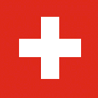
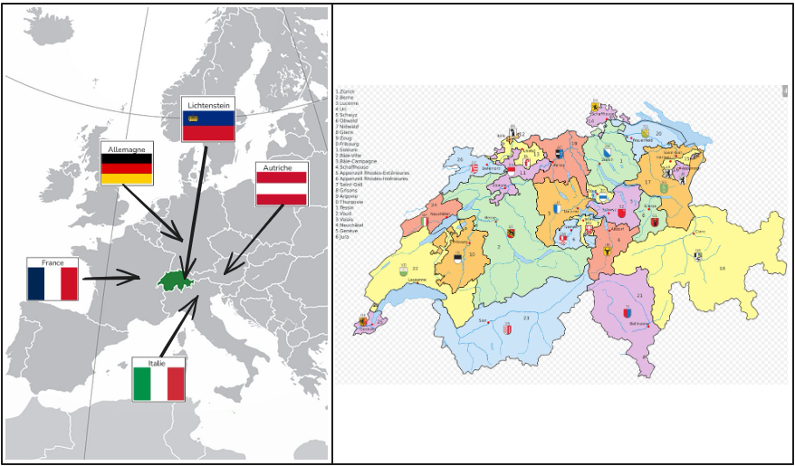
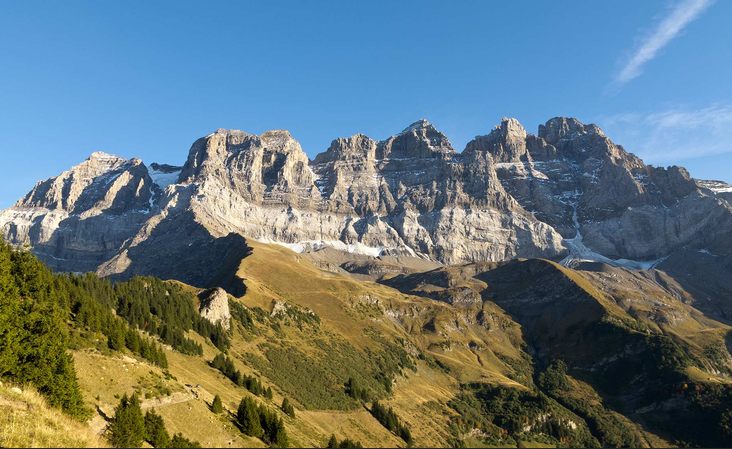

<figure class="gallery-item">
    
    <figcaption>Drapeau de la Suisse</figcaption>
  </figure>

La Suisse se trouve au cœur de l'Europe, entourée par la France à l'ouest, l'Allemagne au nord, l'Autriche et le Liechtenstein à l'est, et l'Italie au sud. Sa superficie est de 41'293 km², un territoire marqué par la diversité de ses reliefs, dominé par les Alpes au sud et à l'est, et le plateau suisse au centre. En 2024, on y recense environ 8'900'000 habitants. Le pays possède quatre langues nationales : l'allemand, le français, l'italien et le romanche. La monnaie nationale est le franc suisse (CHF).

<figure class="gallery-item">
    
    <figcaption>Carte de la Suisse au centre de l'Europe</figcaption>
  </figure>

C'est un pays au climat tempéré, variant selon l'altitude : un climat doux dans le plateau et plus rigoureux en montagne. La Suisse est historiquement connue pour son secteur agricole (fromages, chocolat), mais son économie est aujourd'hui l'une des plus performantes au monde. Elle excelle dans les secteurs de la finance, de l'industrie pharmaceutique et de l'horlogerie de précision.

La base de l'alimentation est variée, avec une forte tradition de produits laitiers et de céréales. L'espérance de vie à la naissance est l'une des plus élevées au monde, dépassant les 83 ans. Le PIB par habitant est parmi les plus hauts du globe, reflétant une grande prospérité économique.

La capitale administrative est Berne, bien que Zurich et Genève soient les centres économiques et diplomatiques les plus influents. Genève, en bord de lac, accueille le siège européen des Nations Unies et de nombreuses organisations internationales, faisant de la ville un carrefour mondial de la diplomatie.

Plus de statistiques : [Statistiques mondiales, fiche Suisse](https://www.statistiques-mondiales.com/suisse.htm)

Site officiel : [Confédération Suisse](https://www.admin.ch)

Les Dents du Midi
# Histoire

Sources: [wikipédia](https://wikipedia/)

**Ier siècle av. J.-C. :** Présence des Celtes (Helvètes), puis conquête romaine. La Suisse devient une province romaine.

**Vème - IXème siècles :** Invasions et installations de divers peuples (Burgondes, Alamans).

**1291 :** Le Pacte fédéral est conclu entre les cantons d'Uri, Schwyz et Unterwald, acte fondateur de la Confédération helvétique.

**XVe - XVIème siècles :** Expansion territoriale et renommée mondiale des mercenaires suisses.

**1531 :** Division religieuse du pays entre catholiques et protestants suite à la Réforme.

**1648 :** Traité de Westphalie : la Suisse obtient officiellement son indépendance vis-à-vis du Saint-Empire romain germanique.

**1798 :** Invasion napoléonienne et création de la République helvétique.

**1815 :** Le Congrès de Vienne reconnaît la neutralité perpétuelle de la Suisse.

**1848 :** Adoption d'une Constitution fédérale. La Suisse devient un État fédéral avec Berne comme ville fédérale.

**1914-1945 :** Pendant les deux guerres mondiales, la Suisse maintient sa neutralité armée, tout en devenant un centre financier et humanitaire crucial.

**1920 :** La Société des Nations (SDN) s'installe à Genève, confirmant le rôle de la Suisse comme terre de dialogue.

**1945 :** La Suisse devient membre fondateur de l'Organisation mondiale du commerce (OMC) et rejoint l'ONU plus tard, en 2002.

**1971 :** Le droit de vote et d'éligibilité est enfin accordé aux femmes au niveau fédéral.

**1992 :** Le peuple suisse rejette, par vote, l'adhésion à l'Espace économique européen (EEE).

**2002 :** Adhésion officielle à l'Organisation des Nations Unies (ONU).

**2010-2020 :** Renforcement des accords bilatéraux avec l'Union européenne pour maintenir l'accès au marché unique tout en préservant la souveraineté nationale.

**2024-2026 :** La Suisse continue de s'adapter aux défis climatiques (fonte des glaciers) et à la transition numérique, tout en restant un pôle mondial d'innovation et de stabilité financière.
