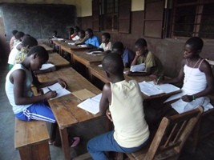

Découvrez les principales actions que l'association Enfants-Kara Togo entreprend.

<figure class="gallery-item">
  
  <figcaption>Elèves studieux</figcaption>
</figure>
Le 31 octobre 2001, au retour de leur visite au Togo, Rose et Claude Balmer racontent à Jo Murer ce qu’ils ont découvert à Kara. Touchés par la situation des enfants de l’orphelinat de l’ODPE, ils décident ensemble de créer l’association Enfants-Kara, afin de leur apporter soutien et aide.

Depuis ses débuts, l’association s’est développée et a su fédérer autour d’elle un groupe fidèle de cotisants. Leur soutien permet de financer les besoins essentiels des enfants et des jeunes qu’elle accompagne.

En 2013, l’association commence à soutenir le foyer L’Espérance, à Tigbada. En 2018, elle fonde au Togo l’ONG Enfants-Kara Togo (EKT), tandis que l’association prend le nom d’Enfants-Kara Suisse (EKS). Au début de 2019, EKS décide également d’aider le foyer Caredo, à Blitta, et lance la distribution de kits professionnels aux apprentis du foyer L’Espérance.

En 2025, l’achat d’un terrain à Yalloumbé se concrétise. L’année suivante débute le projet de construction d’une savonnerie.

Nos principaux axes d’action sont :
- Le foyer de [Ste-Marguerite (ODPE)](/foyers/le-foyer-ste-marguerite/) à Kara
- Le foyer de [l'Espérance](/foyers/le-foyer-esperance/) à Tigbada
- Le foyer [Caredo](/foyers/le-foyer-caredo/) à Blitta
- La savonnerie à Yaloumbé

