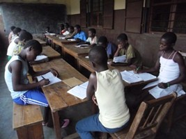

Découvrez les principales actions que l'association Enfants-Kara Togo entreprend.

<figure class="gallery-item">
  
  <figcaption>Elèves studieux</figcaption>
</figure>
Le 31 octobre 2001, de retour d’un voyage au Togo, Rose et Claude Balmer partagent avec Jo Murer et Denis Poisat leurs découvertes à Kara. Profondément touchés par la situation des enfants accueillis à l’orphelinat de l’ODPE, ils décident ensemble de créer l’association Enfants-Kara, afin de leur apporter soutien et assistance.

Au fil des années, l’association grandit et rassemble autour d’elle un fidèle réseau de cotisants. Grâce à leur engagement, elle peut répondre aux besoins essentiels des enfants et des jeunes qu’elle accompagne.

Voici les grandes étapes de son parcours :

- **2001** : fondation de l’association Enfants-Kara ([statuts](/enfants-kara-suisse-eks/statuts/)).
- **2013** : début du soutien au foyer L’Espérance, à Tigbada.
- **2018** : fondation de l’ONG Enfants-Kara Togo (EKT); l’association devient Enfants-Kara Suisse (EKS).
- **2019** : début de l’aide au foyer Caredo, à Blitta, et lancement de la distribution des kits professionnels aux nouveaux diplômés du foyer L’Espérance.
- **2025** : achat d’un terrain à Yaloumbé et lancement du projet de construction d’une savonnerie.
- **2026** : démarrage de la fabrication de savons.

Nos principaux axes d’action sont :
- Le foyer de [Ste-Marguerite (ODPE)](/foyers/le-foyer-ste-marguerite/) à Kara
- Le foyer de [l'Espérance](/foyers/le-foyer-esperance/) à Tigbada
- Le foyer [Caredo](/foyers/le-foyer-caredo/) à Blitta
- La savonnerie à Yaloumbé

