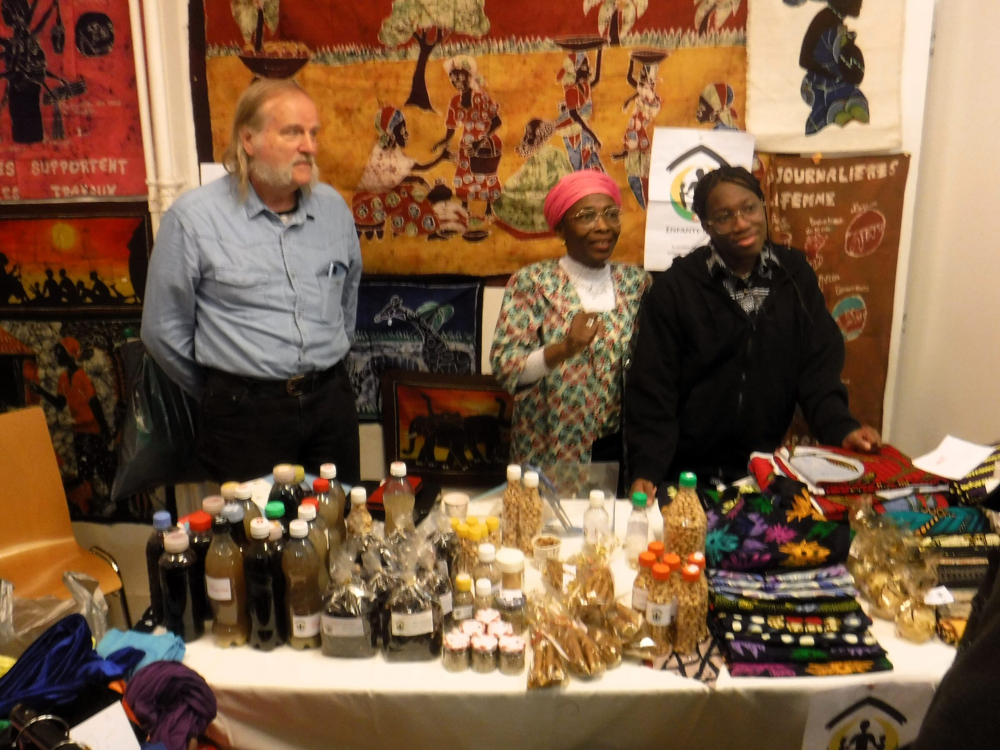
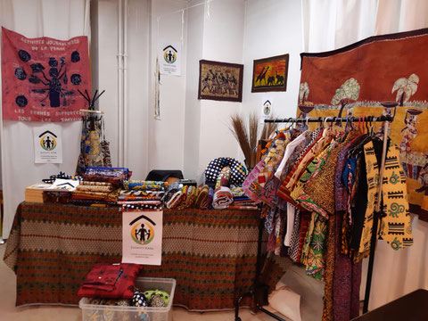
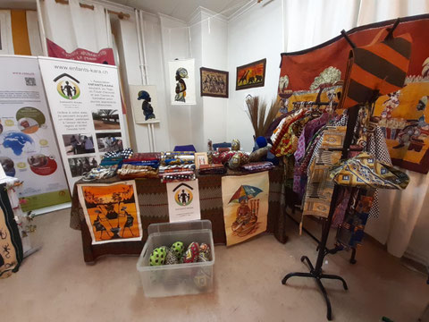
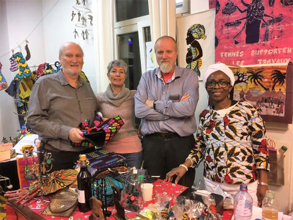
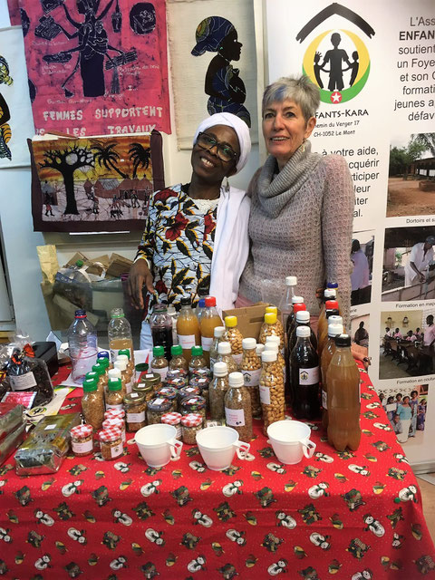

Fidèle au rendez-vous, l'association Enfants-Kara participe régulièrement au marché de Noël du Centre socioculturel de Pôle Sud. Chaque mois de décembre, nos bénévoles transforment leur stand en une véritable escale togolaise. Entre les parfums envoûtants du gingembre, du thé, du café et du sirop d'hibiscus, et l'éclat des textiles colorés et des sculptures en bois, les visiteurs peuvent s'imprégner de l'artisanat local dans un cadre magnifiquement décoré.

Les articles présentés, soigneusement sélectionnés au Togo, nous sont parvenus grâce à l'engagement exceptionnel de notre Présidente, Rose Balmer, et de sa famille, qui ont assuré leur transport jusqu'en Suisse. Au-delà du plaisir partagé, ce succès commercial représente un soutien financier majeur pour les projets de l'Association.

---
# 🔴 Marché 2025
Le marché s’est déroulé du 11 au 13 décembre. La foule était nombreuse, et les visiteurs, affables et joyeux. Notre stand n’a pas désempli.

- <figure class="gallery-item">
    
    <figcaption>vue de notre stand</figcaption>
  </figure>

- <figure class="gallery-item">
    
    <figcaption>bénévoles (g à d, Claude Balmer, Anouche Zeller, Nathalie Betcha)</figcaption>
  </figure>

---
# 🔴 Marché 2024
Le marché s’est déroulé du 12 au 14 décembre dans une ambiance chaleureuse.

- <figure class="gallery-item">
    
    <figcaption>Vue du stand Enfants-Kara</figcaption>
  </figure>

- <figure class="gallery-item">
    
    <figcaption>Famille Balmer au complet (de g à d, Claude, Rose et Déou)</figcaption>
  </figure>

- <figure class="gallery-item">
    
    <figcaption>Madame la présidente d'EKS, Rose Balmer</figcaption>
  </figure>

- <figure class="gallery-item">
    
    <figcaption>Membres au travail (g à d, Anouche Zeller, Claude Balmer, Doris Fleith, Irène Orthman)</figcaption>
  </figure>

---
# 🔴 Marché 2023
Nous n'avons malheureusement pas pu participer au marché de Noël.

---
# 🔴 Marché 2022
Le marché s’est déroulé du 15 au 17 décembre. Retour d'Enfants-Kara au Marché de Noël 2022 après deux ans d'interruption du au covid, grâce au dévouement des bénévoles de l'association.
Quel plaisir, malgré le travail important nécessaire, d'installer nos tréteaux. Comme d'habitude les bénévoles s'y sont succédés. Qu'ils en soient remerciés. !

- <figure class="gallery-item">
    
    <figcaption>Stand d’artisanat au marché de Noël</figcaption>
  </figure>

- <figure class="gallery-item">
    
    <figcaption>Stand d’Enfants-Kara au marché de Noël</figcaption>
  </figure>

---
# 🔴 Marché 2019
C'est ainsi que du 12 au 14 décembre 2019 une poignée de bénévoles d'EK ont été présents sur un stand bien achalandé. Gingembre en boisson ou poudre, thés, cafés, sirop d'hibiscus en dégustation et à l'achat ont égayé les papilles des visiteurs. Bibelots en bois sculpté, nappages et serviettes colorés, tabliers et chemises étaient en nombre sur l'étal. De belles tentures ont habillé le stand.

Tous les articles étaient en provenance du Togo grâce à des achats effectués sur place lors de son séjour en juillet et transportés grâce au dévouement de la Présidente Rose Balmer et famille.

Au bilan une rentrée d'argent significative pour les comptes de l'Association.

<figure class="gallery-item">
  
  <figcaption>Membres du comité sur le stand</figcaption>
</figure>

Quatre membres du comité surpris sur le stand, de gauche à droite, Steffen Pierre-Alain, Zeller Anouche, Balmer Claude et Balmer Rose. Merci à tous les autres bénévoles invisibles !

<figure class="gallery-item">
  
  <figcaption>Bénévoles derrière les produits du stand</figcaption>
</figure>

Rose Balmer et Anouche Zeller derrière des boissons, cacahouètes, gingembre caramélisé, café et autres.
