# 🔴 Repas de soutient 2025
Cette journée s'est déroulée au refuge des Bas-Monts se trouvant sur la commune de Belmont s/Lausanne.

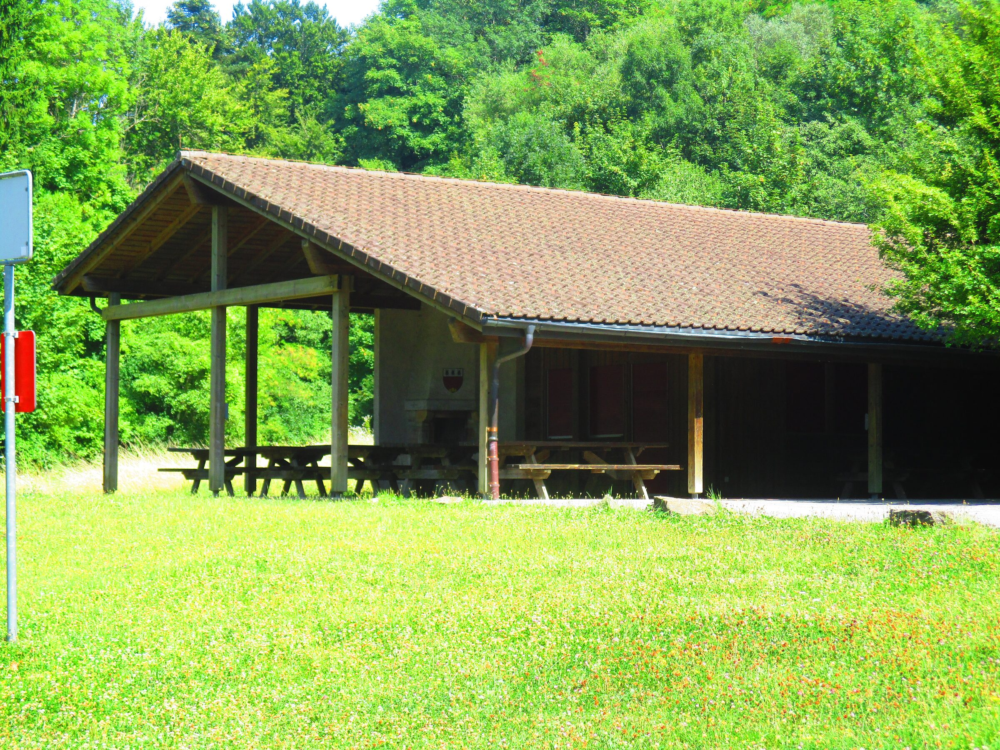
Vue sur le refuge des Bas Monts

Le repas a commencé vers 11h par un apéritif, suivi du repas préparé par une équipe de cuisiniers africains qui nous ont concocté un magnifique repas africain.
Des musiciens africains ont été conviés pour nous faire passer un agréable repas en musique.
Nous avons eu beaucoup de chance. Le temps a été radieux

---
### Carte d'invitation envoyé à tous nos membres

Cliquez sur une image pour l'agrandir.\
Flèches gauche-droite pour changer de photo.\
Tapez Escape pour revenir au format initial.

- <figure class="gallery-item">
    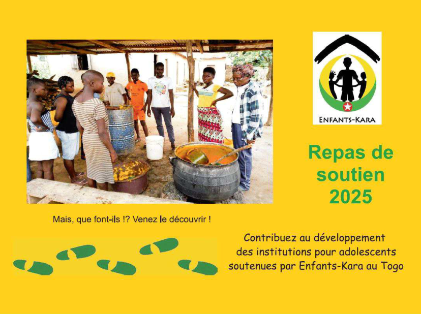
    <figcaption>Invitation au repas de soutien 2025</figcaption>
  </figure>

- <figure class="gallery-item">
    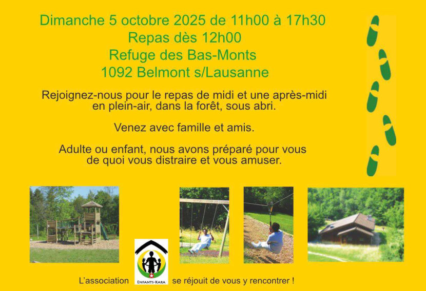
    <figcaption>Invitation au repas de soutien 2025</figcaption>
  </figure>

- <figure class="gallery-item">
    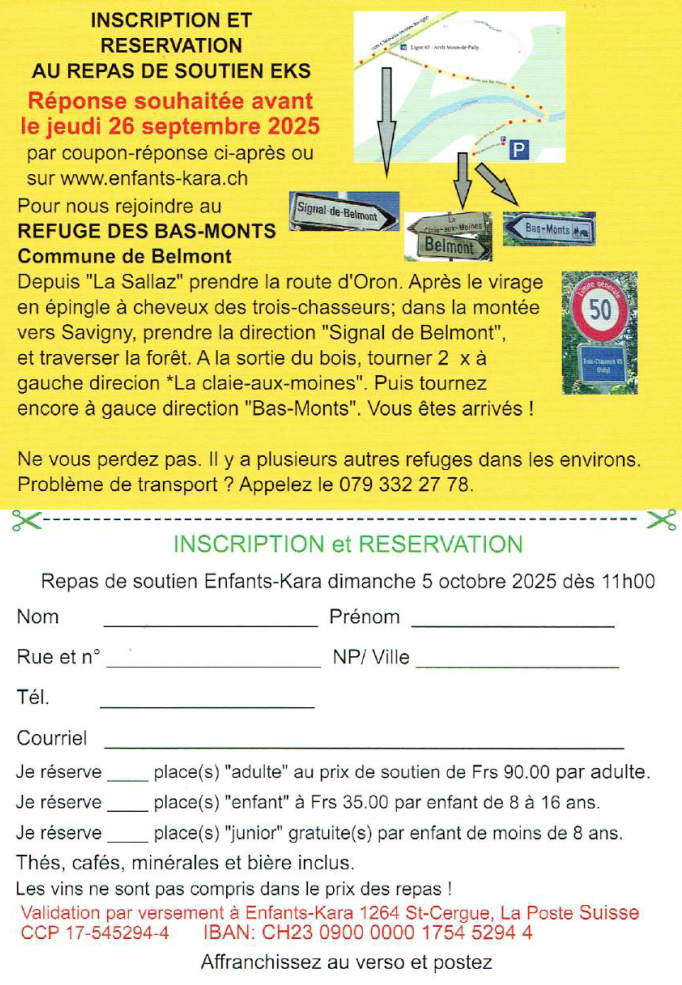
    <figcaption>Invitation au repas de soutien 2025</figcaption>
  </figure>

- <figure class="gallery-item">
    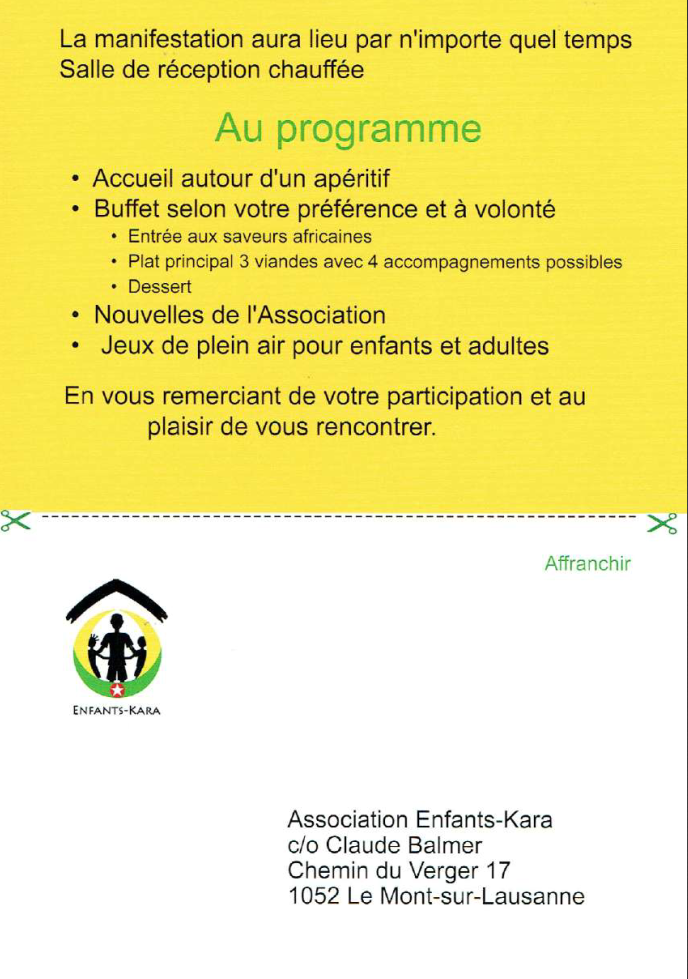
    <figcaption>Invitation au repas de soutien 2025</figcaption>
  </figure>

### Equipe qui nous ont cuisiné le repas aux saveurs africaines

- <figure class="gallery-item">
    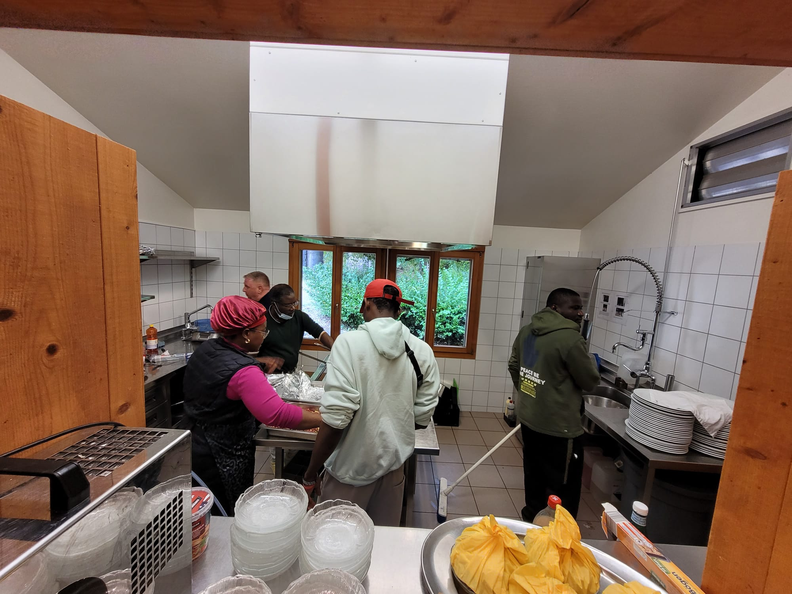
    <figcaption>Equipe au travail</figcaption>
  </figure>

- <figure class="gallery-item">
    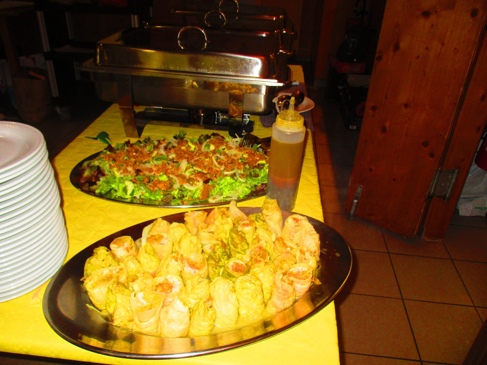
    <figcaption>Vue sur quelques plats préparés</figcaption>
  </figure>

### Musiciens qui ont animés la journée

- 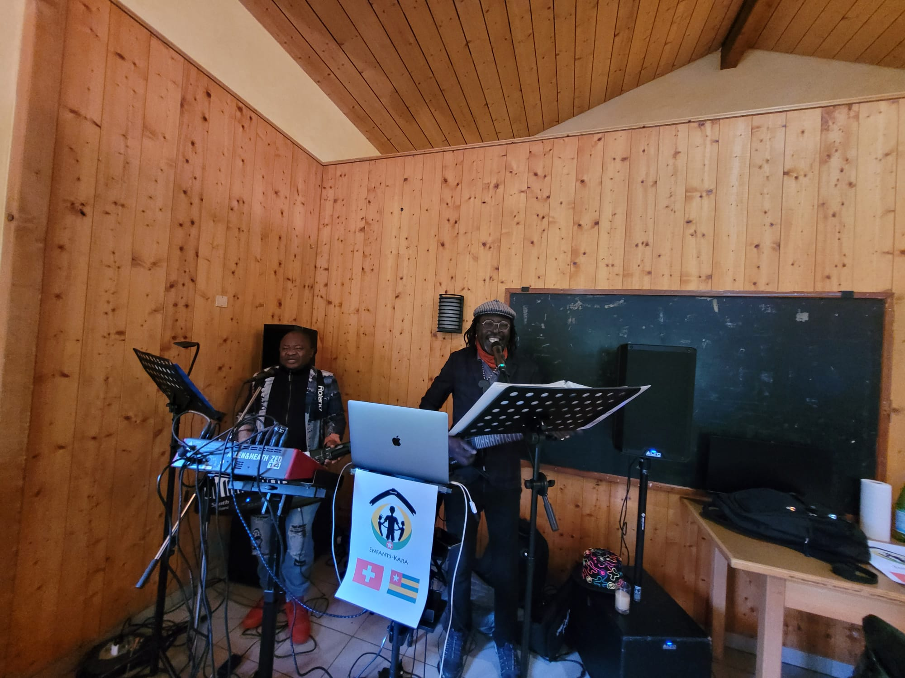
- 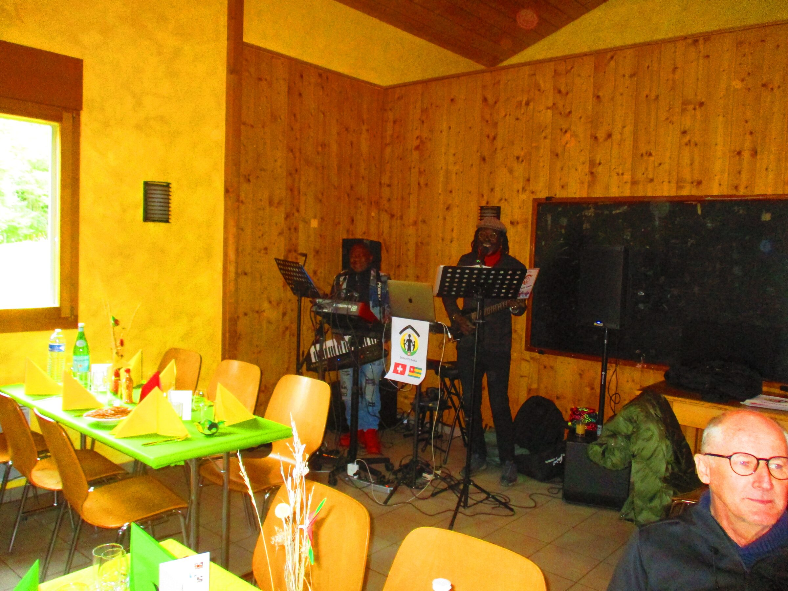

### Discours et présentation de l'association

- <figure class="gallery-item">
    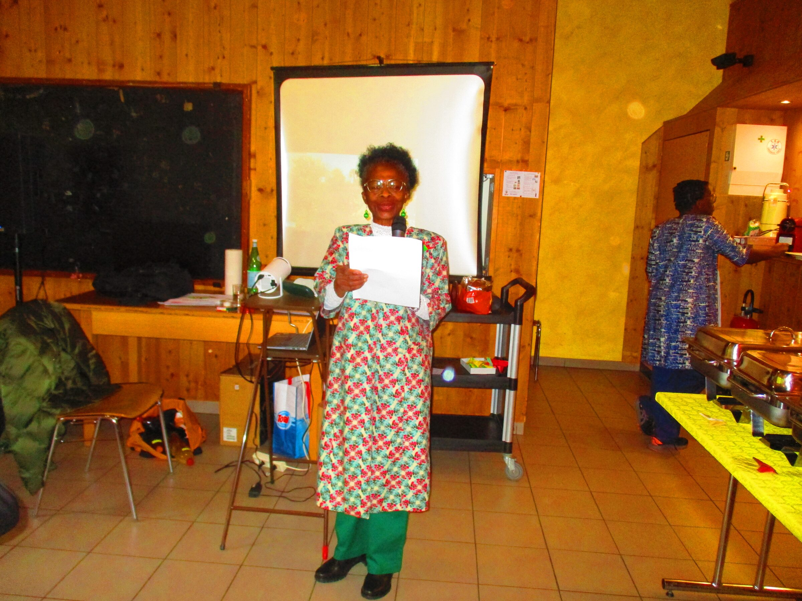
    <figcaption>Discours de la présidente d'EKS, Rose Balmer</figcaption>
  </figure>

- <figure class="gallery-item">
    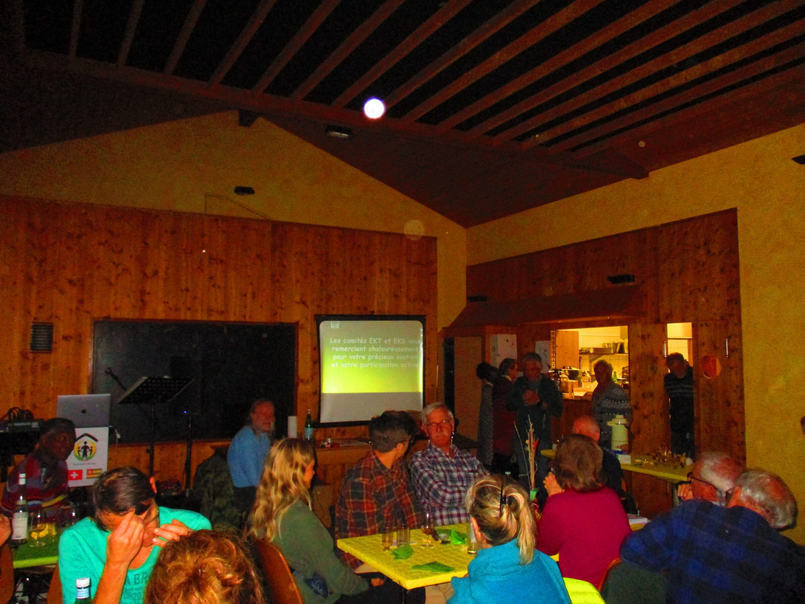
    <figcaption>Présentation des dernières réalisations faites au Togo</figcaption>
  </figure>

### Vues sur les convives

- 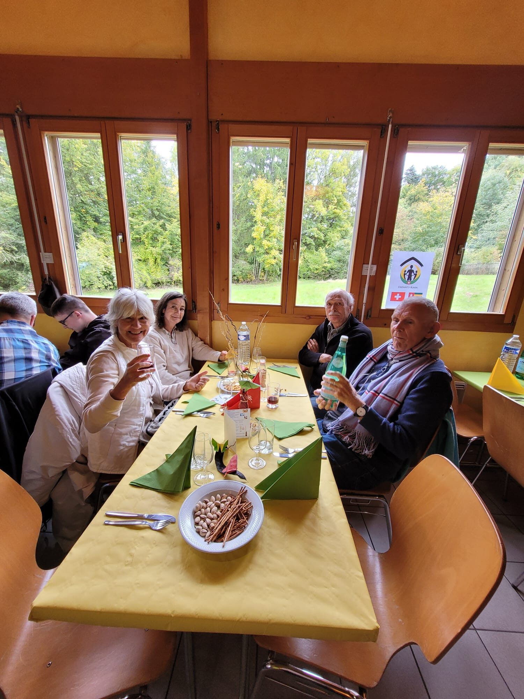
- 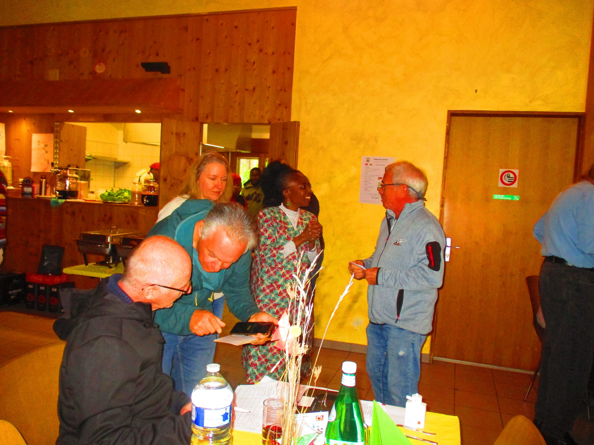
- 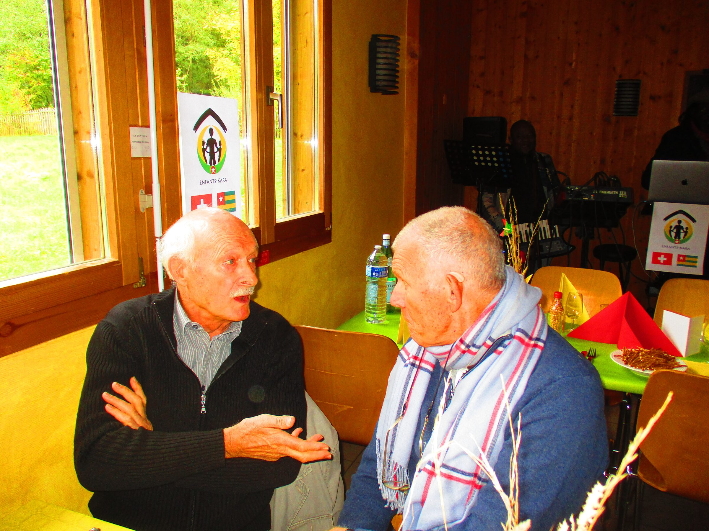
- 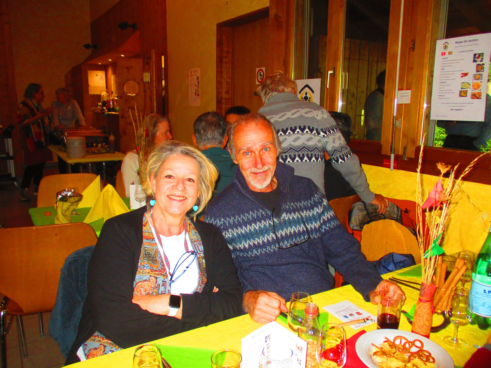
