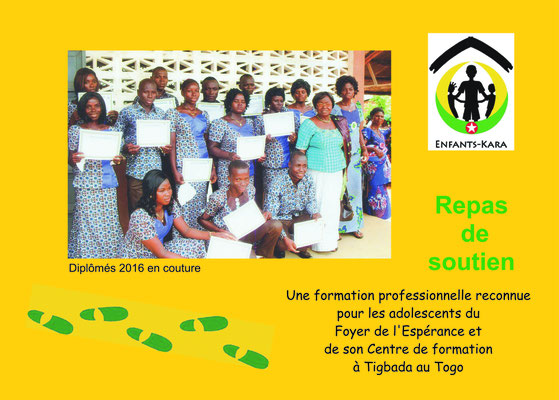
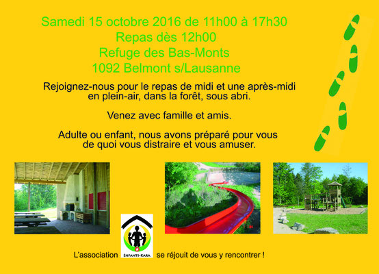
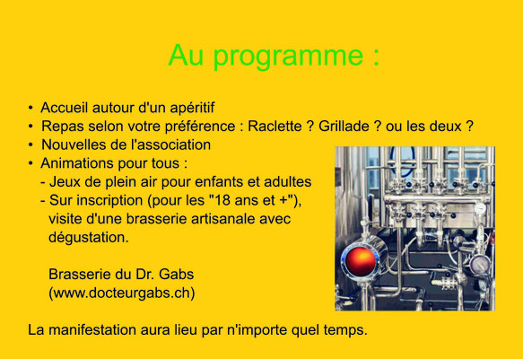
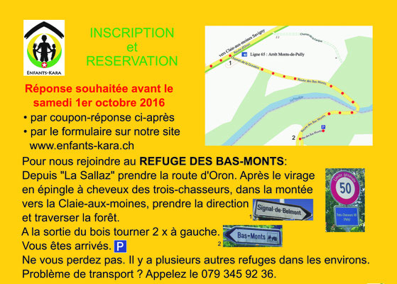
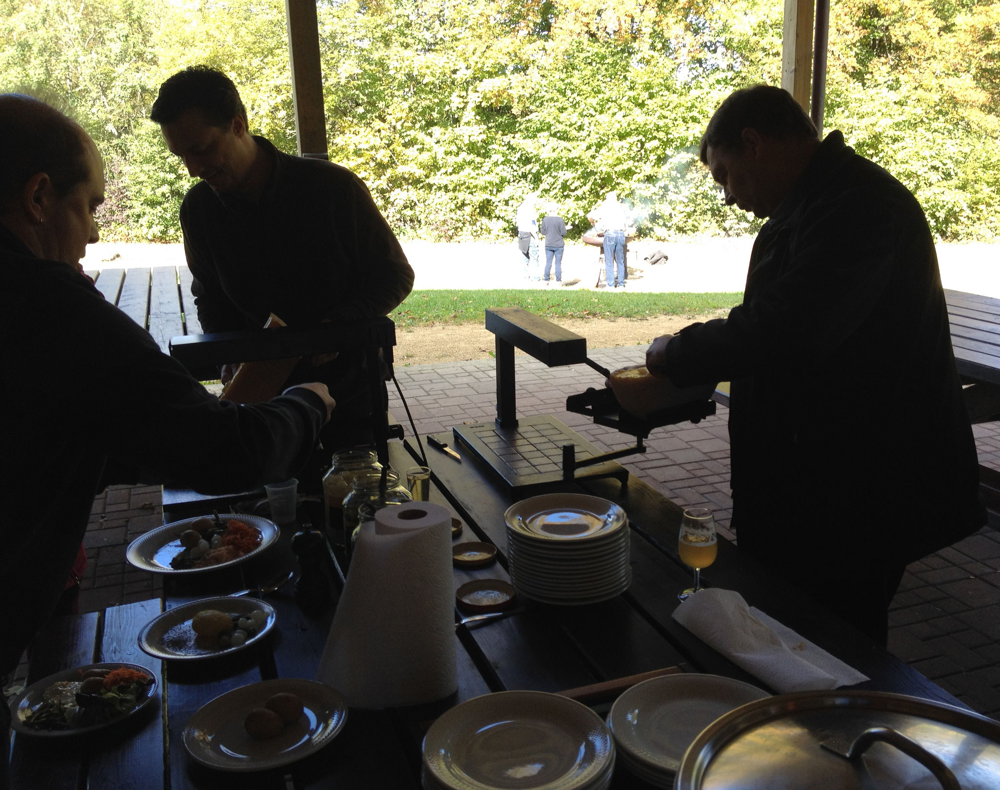
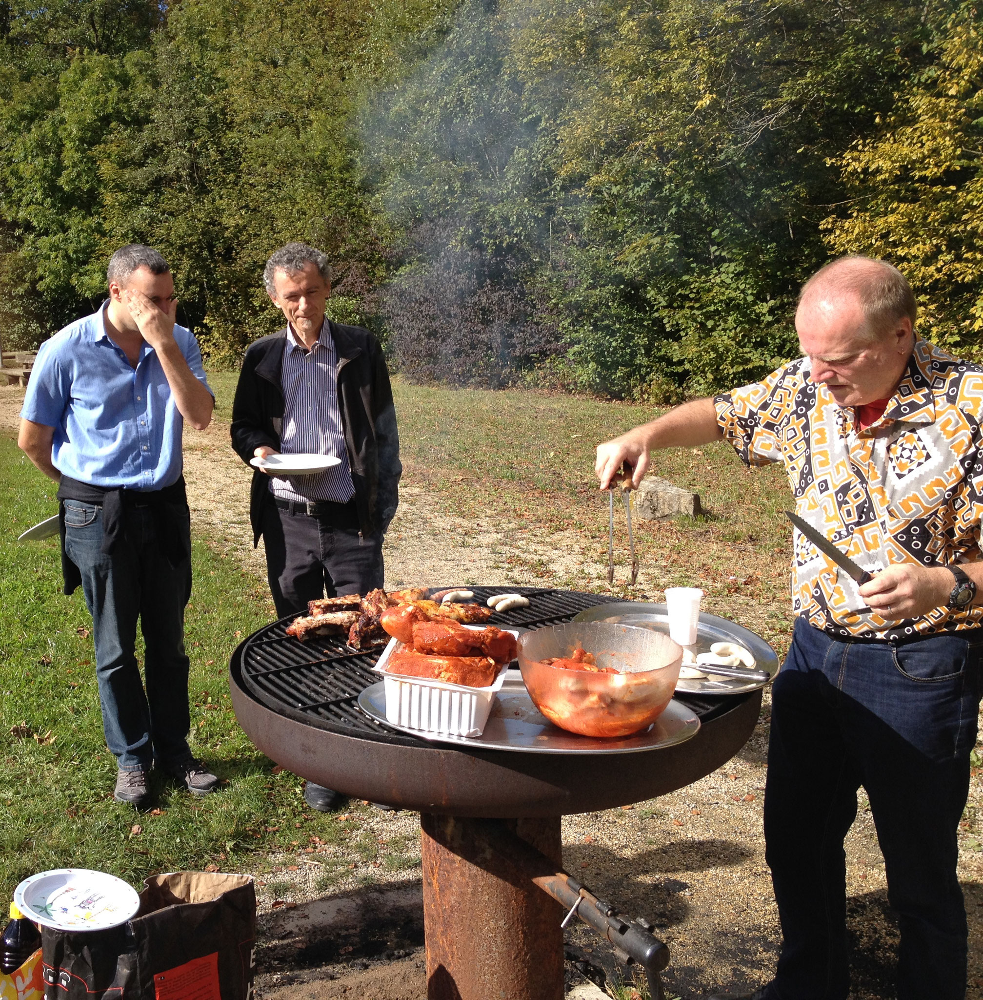
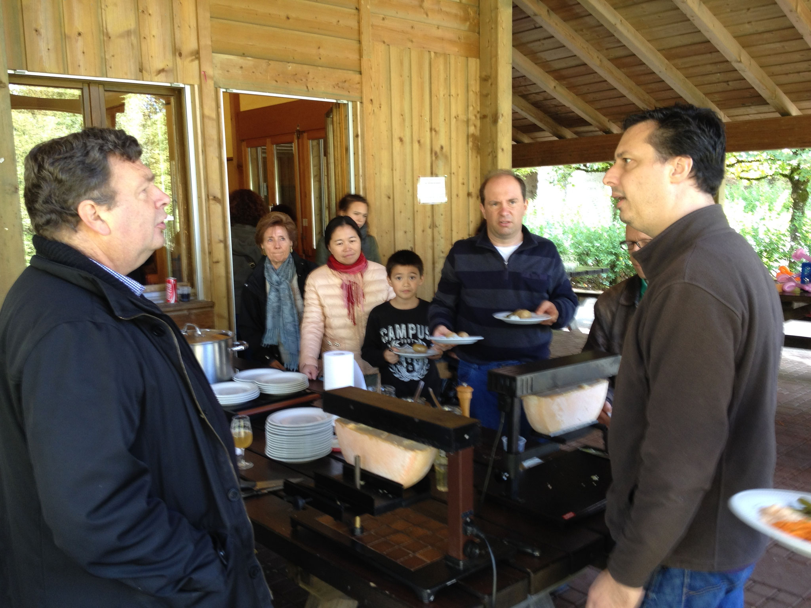

# 🔴 Repas de soutien 2016
Ce repas s'est déroulé le samedi 15 octobre 2016 au Refuge des Bas-Monts qui se trouve sur la commune de Belmont s/Lausanne.

---
### Carte d'invitation envoyé à tous nos membres

Cliquez sur une image pour l'agrandir.\
Flèches gauche-droite pour changer de photo.\
Tapez Escape pour revenir au format initial.

- <figure class="gallery-item">
    
    <figcaption>Invitation au repas de soutien 2016</figcaption>
  </figure>

- <figure class="gallery-item">
    
    <figcaption>Invitation au repas de soutien 2016</figcaption>
  </figure>

- <figure class="gallery-item">
    
    <figcaption>Invitation au repas de soutien 2016</figcaption>
  </figure>

- <figure class="gallery-item">
    
    <figcaption>Invitation au repas de soutien 2016</figcaption>
  </figure>

### Photos sur le racleur et le grilleur

- <figure class="gallery-item">
    
    <figcaption>On a raclé ...</figcaption>
  </figure>

- <figure class="gallery-item">
    
    <figcaption>On a grillé ...</figcaption>
  </figure>

- <figure class="gallery-item">
    
    <figcaption>On s'est régalé !</figcaption>
  </figure>
