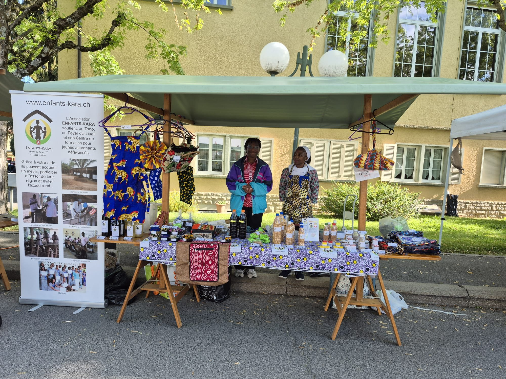

Chaque année, la commune du Mont-sur-Lausanne organise une fête villageoise où artisans et associations locales se réunissent pour présenter leurs créations et leurs activités aux habitants. Cette journée de partage et de découverte attire chaque année un grand nombre de riverains, renforçant ainsi les liens et la convivialité au sein de la communauté.

# 🔴 Fête 2026

<figure class="gallery-item">
    
    <figcaption>Affiche de la fête de mai</figcaption>
  </figure>

Pour la toute première fois, Enfants-Kara a déployé son stand au cœur des rues du Mont-sur-Lausanne. Ce fut une occasion privilégiée de mettre en lumière l'artisanat togolais et de faire découvrir les valeurs et les missions de l'association à ses concitoyens.

<figure class="gallery-item">
    
    <figcaption>Rose et Déou Balmer sur le stand d'Enfants-Kara</figcaption>
  </figure>

Fierté et engagement : Rose et Déou Balmer sur le stand d'Enfants-Kara.
