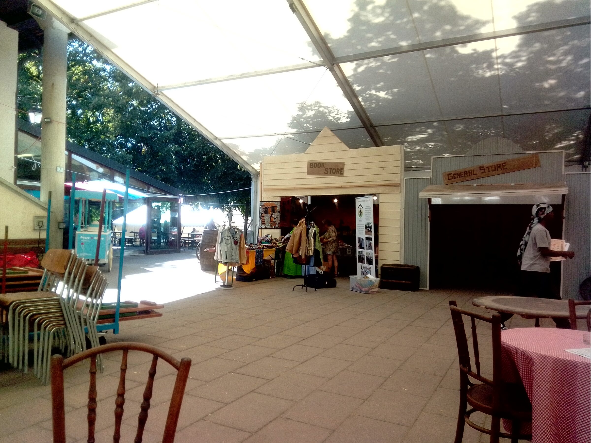
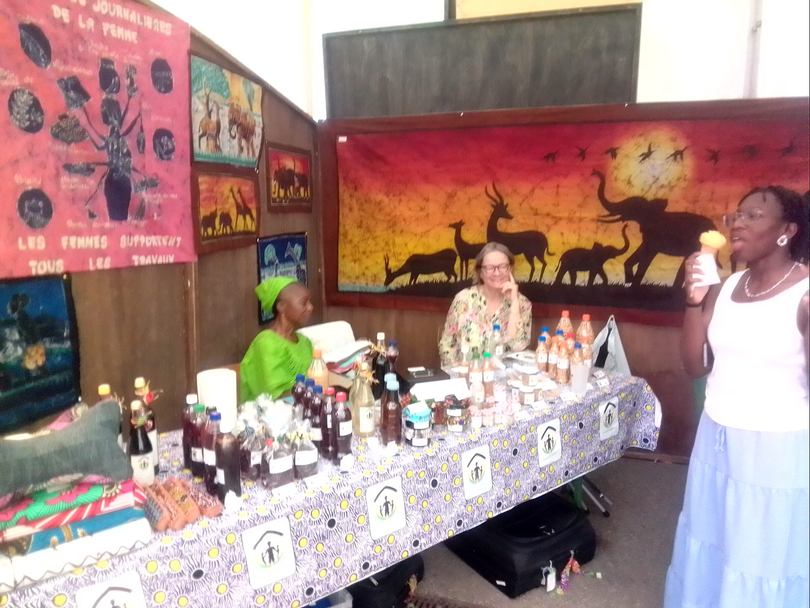

Chaque année, la commune de Chancy, dans le canton de Genève, s'anime au rythme d'un festival country vibrant, où la convivialité et la passion de la musique américaine sont à l'honneur.
# 🔴 Festival 2026
Cette année, l'association Enfants-Kara a fait ses premiers pas au festival country de Chancy, qui s'est tenu du 10 au 12 juillet. Installés dans un bungalow abrité par une immense tente, nous avons fait face à une canicule intense : sous la toile, les températures ont atteint des sommets. Heureusement, parmi nos trésors d'artisanat togolais, nous proposions des éventails traditionnels qui, face à la chaleur accablante, ont trouvé preneurs en un clin d'œil !

<figure class="gallery-item">
    
    <figcaption>Vue de notre stand sous la tente</figcaption>
  </figure>

Une vue de notre stand sous la tente

<figure class="gallery-item">
    
    <figcaption>Quelle chaleur</figcaption>
  </figure>

Mais ce qu'il faisait chaud

La fête fut belle et les ventes intéressantes.
