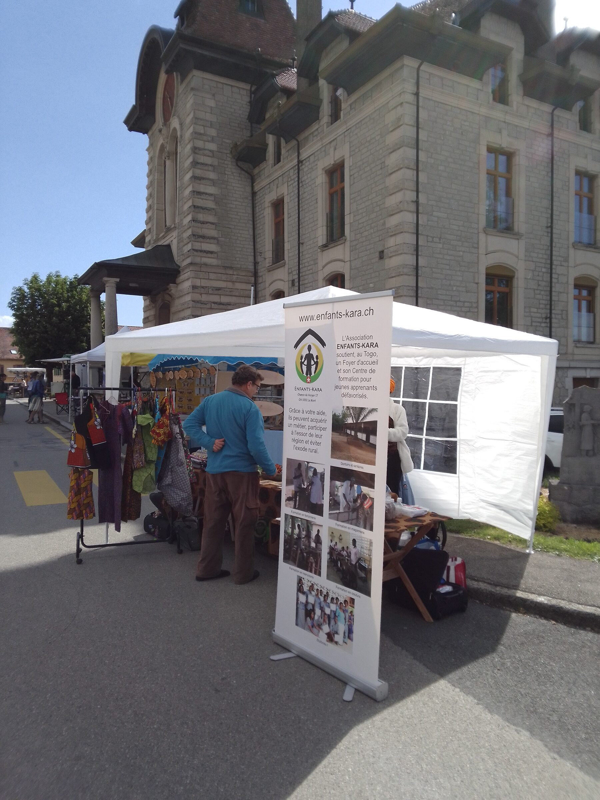
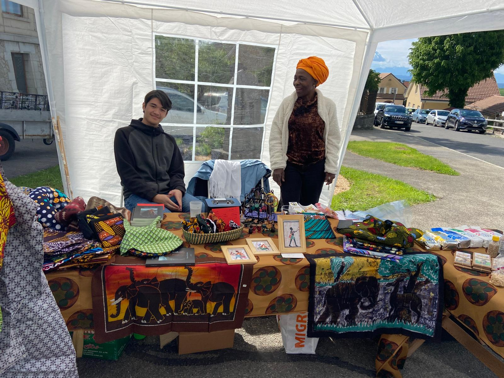

L'association ne manque aucune occasion de se faire connaître et déploie régulièrement son stand lors de différents événements.

# 🔴 Baulmes 2024
Le 18 mai 2024, à Baulmes, perchée sur les hauteurs d'Yverdon, que l'association Farafina organise chaque année un marché aux saveurs et couleurs du monde. À travers cet événement, Farafina — qui œuvre pour la santé des enfants au Mali et la richesse des cultures africaines — invite d'autres associations à présenter des produits artisanaux venant directement des pays aidés, créant ainsi un pont solidaire entre les continents.

<figure class="gallery-item">
    
    <figcaption>Tente Enfants-Kara</figcaption>
  </figure>

Notre tente 

<figure class="gallery-item">
    
    <figcaption>Assortiment</figcaption>
  </figure>

Notre assortiment en images.

Une journée qui commençait si bien... mais la nature en a décidé autrement ! ⛈️ En milieu d'après-midi, l'orage et le vent ont frappé, nous obligeant à un combat rapide pour maintenir notre stand. La pluie a fini par nous forcer à plier bagages plus tôt que prévu. Quel dommage !