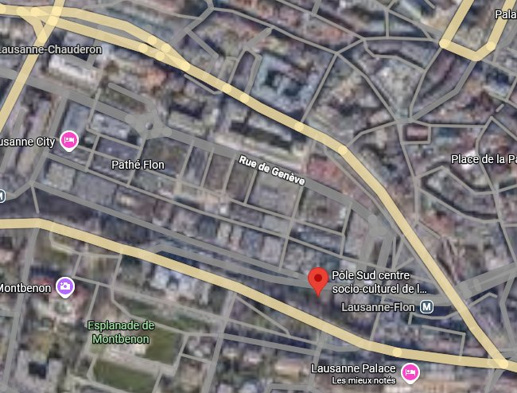

**Nos événements et manifestations**
Pour soutenir ses actions et partager la richesse de la culture africaine, Enfants-Kara organise divers événements tout au long de l'année.

**Soirées de soutien**
Environ tous les deux ans, nous organisons une grande soirée de soutien. Convivialité, chants et danses sont les maîtres-mots de ces rencontres, créant une atmosphère festive et solidaire.

**Repas africains**
Saisissant les opportunités, nous organisons des repas aux saveurs d'Afrique, notamment pour clôturer les cours de danse d'expression africaine à la Maison Saint-Jean-de-Cours, à Lausanne. C'est un moment privilégié de partage et de gourmandise.

**Stands et marchés**
L'association marque également sa présence sur divers marchés d'été ou de Noël. À travers la vente d'objets artisanaux, ces journées sont l'occasion de belles rencontres avec d'autres associations, des partenaires et de nombreux sympathisants.

Toutes nos activités sont annoncées et mises à jour régulièrement sur notre page "Manifestations".

# Prochaine date à retenir: 10-12 décembre 2026
Au Centre socioculturel de Pôle Sud, avenue Jean-Jacques Mercier 3, Lausanne

<figure class="gallery-item">
    
    <figcaption>Pôle Sud</figcaption>
  </figure>

source: google maps
