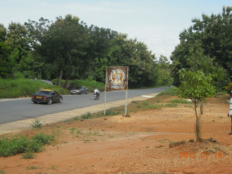
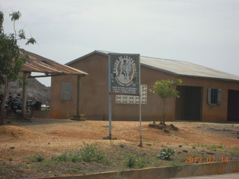
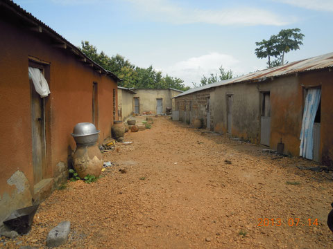
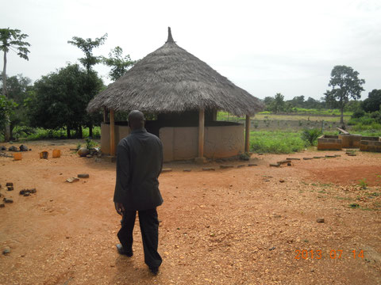
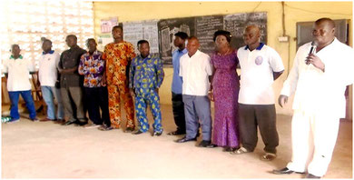

« Mieux vaut apprendre à un jeune enfant à pêcher\
que de lui donner du poisson dans un plat. »

Un enfant de la rue, orphelin, démuni ou victime de la traite est protégé dans le cercle des personnes de bonne volonté qui l'accueillent à bras ouverts pour l'éduquer, le former et lui apprendre à construire son avenir à travers un métier de son choix.

Panneau signalant le foyer de l'Espérance au bord de la nationale RN1

- <figure class="gallery-item">
     
     <figcaption>Le panneau de l'institution sur la RN1</figcaption>
  </figure>

- <figure class="gallery-item">
     
     <figcaption>Locaux administratifs</figcaption>
  </figure>

- <figure class="gallery-item">
     
     <figcaption>Dortoirs</figcaption>
  </figure>

- <figure class="gallery-item">
     
     <figcaption>L'apatam ou coin de discussions</figcaption>
  </figure>

## Structure administrative
Les organes dirigeants de l'institution sont:

- Conseil d'administration
- Bureau exécutif constitué de 5 formateurs ou patrons
- Comité de gestion composé de
  - 5 représentants des apprenants
  - 2 représentants des patrons
  - 1 représentant des éventuels parrains/marraines ou parenté des apprenants

<figure class="gallery-item">
    
    <figcaption>Dirigeants de FE</figcaption>
  </figure>

{ .text-align-center .caption}

## But et objectifs
Contribuer à l'épanouissement socio-économique des jeunes issus des familles pauvres par la formation professionnelle gratuite.

Susciter le goût de la formation chez les jeunes en déperdition scolaire et vicitimes de la traite.

Assurer une formation professionnelle aux jeunes des deux sexes.

Favoriser l'accès à la culture générale et au savoir significatif.

## Conditions d'admission
L'institution est ouverte à tous les jeunes orphelins ou démunis des deux sexes sans distinction de religion ou d'ethnie.

Les frais de formation dans toutes les filières sont gratuits.

Un internat est aussi mis gratuitement à la disposition des apprenants dans les filières disponibles.

Depuis sa création en 2005, le Foyer de l'Espérance a déjà formé plus d'une centaine d'orphelins et de victimes de la traite.

Pendant la scolarité obligatoire, beaucoup d'élèves abandonnent leurs études. Trop souvent, le niveau scolaire atteint est trop bas (illettrisme) et les adolescents ont de la peine à retourner à la terre ou à commencer un apprentissage, faute de trouver des patrons voulant d'eux. Ils partent en ville ou à la capitale à la recherche de l’Eldorado, ignorant qu’ils seront à la merci de toutes les arnaques possibles dont celle de la traite. Les jeunes apprenants du FE sont essentiellement (80% des inscrits) des orphelins et démunis.

Le recrutement des jeunes se fait essentiellement de bouche à oreille; de rares publicités sont, par exemple, passées à la radio locale. Ce sont souvent de proches parents de ces jeunes qui les amènent au Foyer. Un questionnaire est soumis à ces proches, puis une visite à domicile est effectuée. Début 2014, en raison de la taille réduite des dortoirs et de la destruction de l’un deux lors de graves intempéries, seule une quarantaine de jeunes pourront être accueillis. La capacité actuelle d'hébergement est d’un dortoir pour 12 garçons et d’un autre dortoir pour 34 filles. 21 autres garçons sont logés par des familles en ville de Sotouboua.

La nourriture de tous est assurée par des proches dans la mesure de leurs souvent maigres moyens ou par parrainage.

 Le Centre de formation accompagne les jeunes jusqu'à l'obtention du CFA (certificat de fin d'apprentissage), en règle générale après 3 ans d'études et d’expériences pratiques. L'encadrement est assuré par des artisans locaux professionnels et dispense les formations dans les domaines suivants : maçonnerie, électricité en bâtiment, menuiserie, couture et tissage, mécanique des deux roues, forge et soudure. Des ateliers, malheureusement équipés d'un outillage trop élémentaire, sont réservés aux exercices pratiques.
