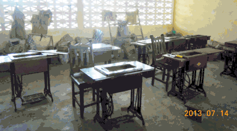
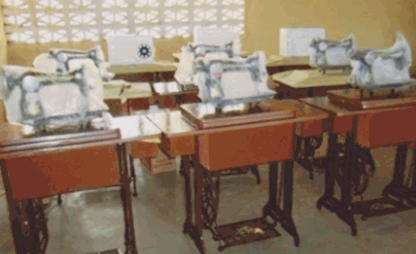
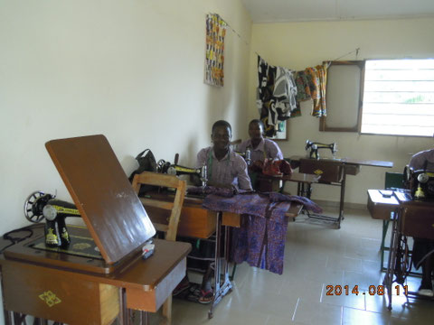

# Coup dur en juillet 2013

<figure class="gallery-item">
    
    <figcaption>Salle de couture sans machines</figcaption>
  </figure>

Les machines à coudre de la salle de couture ont été volées. Tristesse et résignation, sont les sentiments qu'ont ressentis les enseignants et les élèves en couture du Centre de formation.

Où sont passées les 10 machines à coudre qu'ils avaient commencé à apprendre à utiliser ?
Mystère devant ce qui était pour eux une catastrophe.

---
# Action réparatrice

En janvier 2014, faute de finances, la classe de couture n'avait toujours pas recouvré ses capacités d'enseignement.

ENFANTS-KARA ne pouvait que réagir.

Grâce à une action "Flash" menée dans le cadre du comité d'EK et d'amis de ses membres, une levée de fonds a pu être mise en place avec succès. En une quinzaine de jours, le montant nécessaire à l'achat de nouvelles machines a été récolté et transmis aux dirigeants du Centre. Quelques semaines plus tard, le comité d'EK a été informé du succès de l'opération; des machines à coudre toutes neuves avaient rejoint les tables de couture.

<figure class="gallery-item">
    
    <figcaption>Nouvelles machines à coudre</figcaption>
  </figure>

Nouvelles machines flambantes neuves

<figure class="gallery-item">
    
    <figcaption>Atelier de couture en activité</figcaption>
  </figure>

Jeunes au travail
