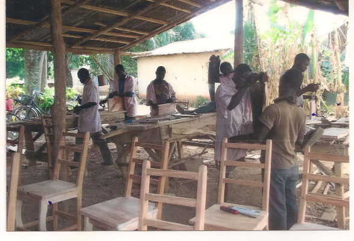
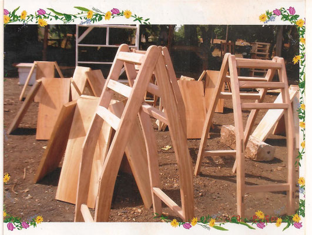
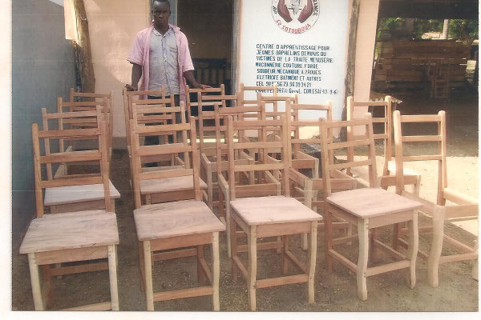
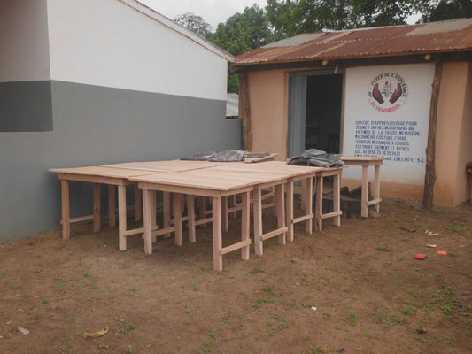
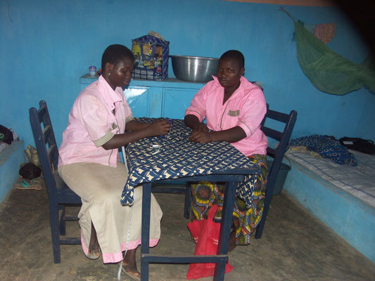
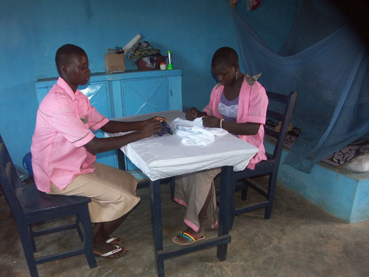
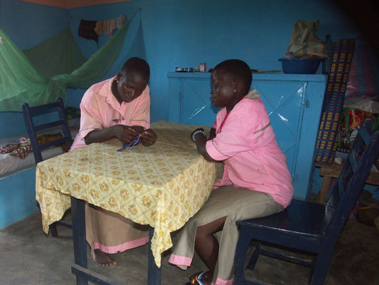
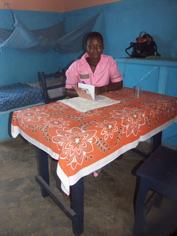
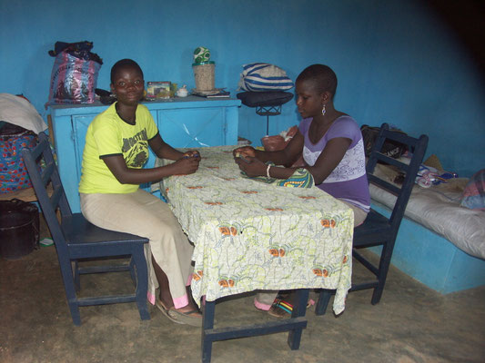

Après la construction des nouveaux dortoirs pour les filles (2014), suite à un souhait de la Direction du Foyer, une "Action flash" a permis de récolter le montant nécessaire pour la construction de meubles pour les chambres. Avec cette somme, les apprenants menuisiers du Centre de formation ont pu fabriquer 10 tables et 20 chaises. Merci aux généreux donateurs et donatrices ainsi qu'à ces constructeurs en formation.

- <figure class="gallery-item">
    
    <figcaption>Fabrication par les apprenants</figcaption>
  </figure>

- <figure class="gallery-item">
    
    <figcaption>Pièces pour chaises</figcaption>
  </figure>

- <figure class="gallery-item">
    
    <figcaption>Chaises</figcaption>
  </figure>

- <figure class="gallery-item">
    
    <figcaption>Tables</figcaption>
  </figure>

- <figure class="gallery-item">
    
    <figcaption>Élèves assis autour d’une table</figcaption>
  </figure>

- <figure class="gallery-item">
    
    <figcaption>Élèves devant une table</figcaption>
  </figure>

- <figure class="gallery-item">
    
    <figcaption>Deux élèves autour d’une table</figcaption>
  </figure>

- <figure class="gallery-item">
    
    <figcaption>Élève à sa table</figcaption>
  </figure>

- <figure class="gallery-item">
    
    <figcaption>Deux élèves assis à une table</figcaption>
  </figure>

Cliquez sur une image pour l'agrandir.\
Flèches gauche-droite pour changer de photo.\
Tapez Escape pour revenir au format initial.
{ .text-align-center .caption}
