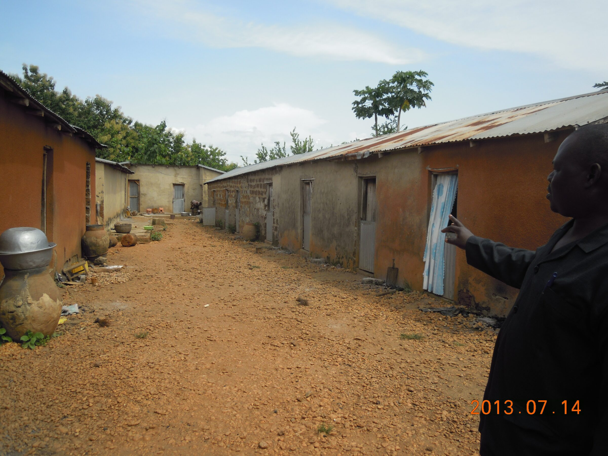
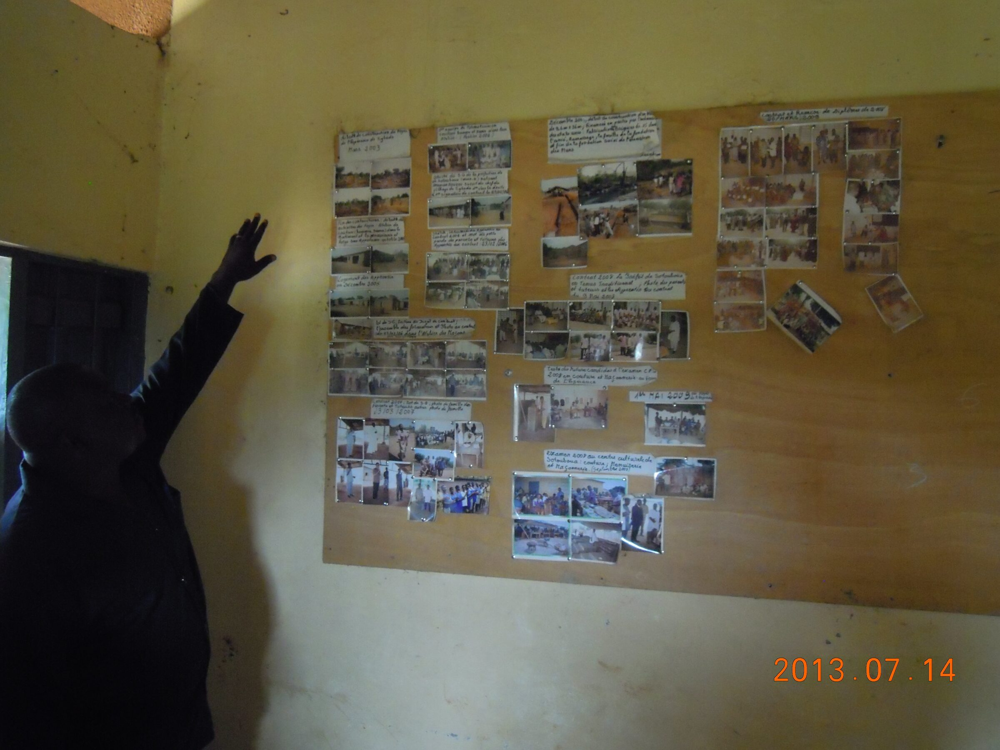
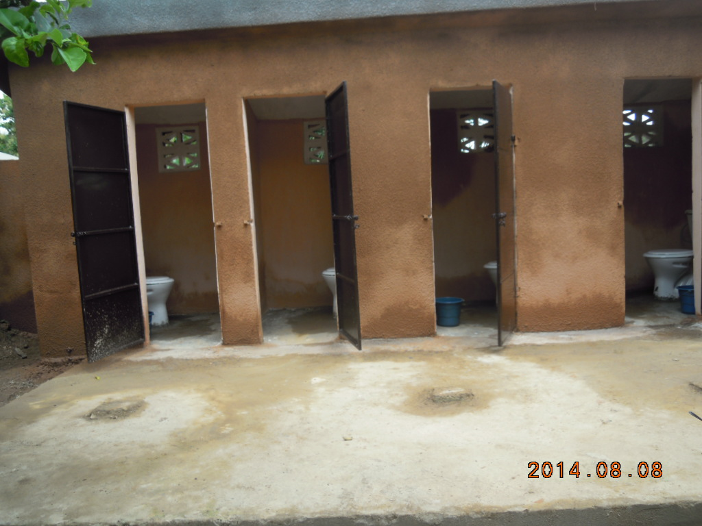

Dès 2013, EKS fournit au foyer de l'Espérance des aides ponctuelles. Plus particulièrement, construction de bâtiments techniques (ateliers de mécanique), des dortoirs. Amélioration de la structure d'accueil, fourniture de matériel et surtout, pour les apprentis ayant reçu leur diplôme, fourniture d'un kit d'outillage pour démarrer dans la vie professionnelle.

<figure class="gallery-item">
    
    <figcaption>Anciens dortoirs</figcaption>
  </figure>

<figure class="gallery-item">
    
    <figcaption>Présentation des faits saillants du foyer</figcaption>
  </figure>

<figure class="gallery-item">
    
    <figcaption>Nouveaux sanitaires</figcaption>
  </figure>