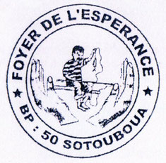
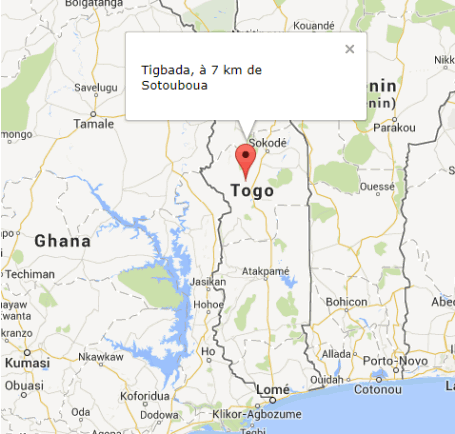
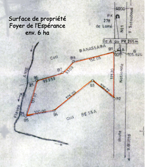
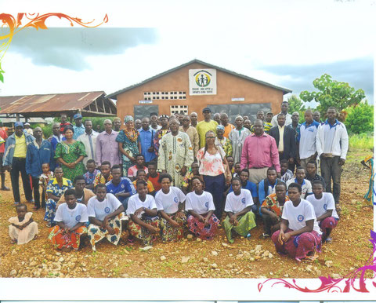

En juillet 2013, grâce à un séjour dans la région de Kara, Rose et Claude Balmer ont pu identifier et visiter plusieurs établissements offrant une formation professionnelle. Après présentation de leur rapport au comité, celui-ci a choisi le Foyer de l'Espérance et son Centre de formation (FE), choix confirmé en Assemblée Générale extraordinaire. Ainsi dès 2014, l'association EK contribue au fonctionnement des structures de cette institution.

<figure class="gallery-item">
    
    <figcaption>Logo du Foyer de l’Espérance</figcaption>
  </figure>

Le Foyer de l'Espérance et son Centre de formation se trouvent dans le village de Tigbada, à côté de la Nationale 1 à 120 km de Kara et à 7 km au sud de la ville de Sotouboua, canton de Tchébébé.

- <figure class="gallery-item">
    
    <figcaption>Carte du Togo avec Tigbada</figcaption>
  </figure>

- <figure class="gallery-item">
    
    <figcaption>Plan du terrain du Foyer de l’Espérance</figcaption>
  </figure>

- <figure class="gallery-item">
    
    <figcaption>Devant le garage pour véhicule et pour motos, photo regroupant les personnes assemblées pour cette rencontre. Le bâtiment à gauche est utilisé par les apprentis forgeron et maçon.</figcaption>
  </figure>
