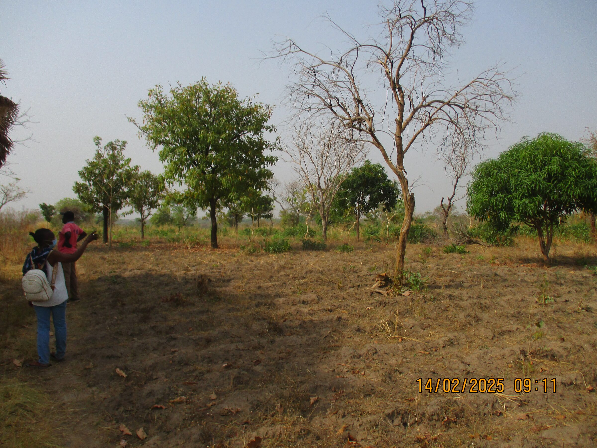
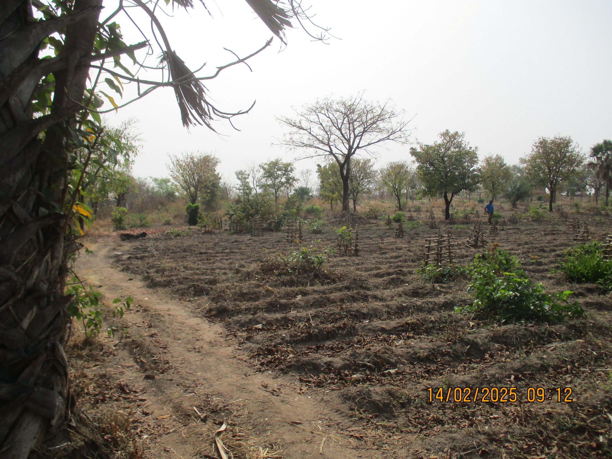
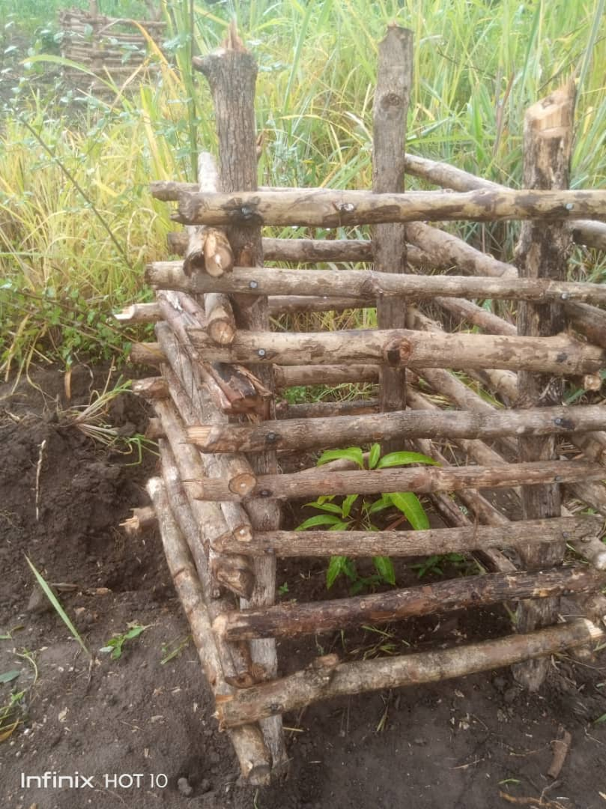
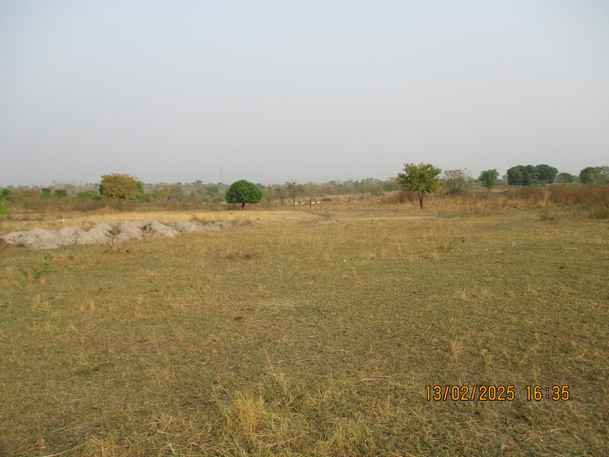
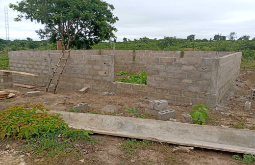
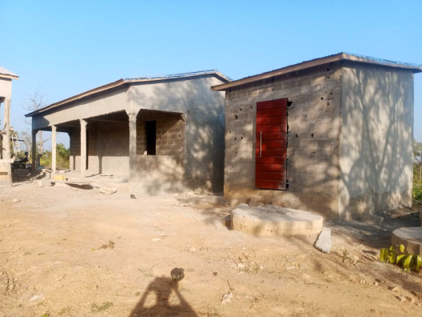
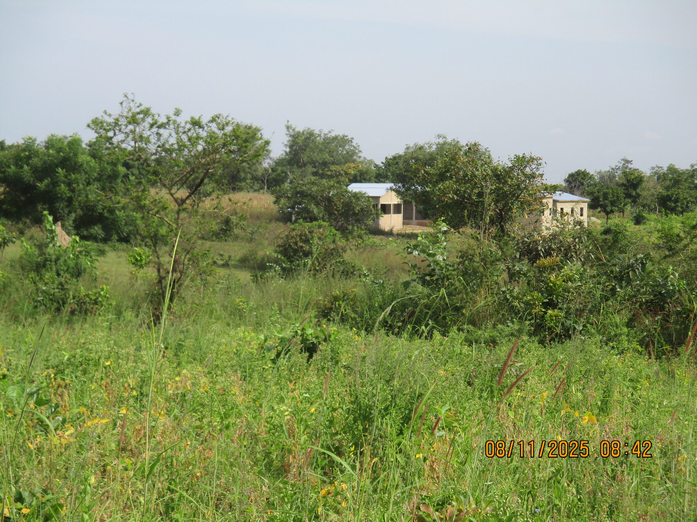

## Changement

Initialement gérée par l’ONG CAREDO, dont Mme Boukpessi est la directrice, cette institution accueille des enfants défavorisés et des orphelins. L’association Enfants-Kara fournit chaque mois à chaque enfant du centre un kit alimentaire. Elle répond également à des besoins ponctuels, comme l’achat de fournitures scolaires ou de vêtements, selon les demandes.

- <figure class="gallery-item">
  
  <figcaption>Centre Caredo</figcaption>
</figure>

- <figure class="gallery-item">
  
  <figcaption>Et sa place de jeux</figcaption>
</figure>

---
Enfants-Kara a également acquis deux terrains. Sur le premier, l’association plante des arbres fruitiers afin de compléter l’alimentation des enfants, ainsi que des palmiers à huile destinés à la fabrication de savon. Sur le second, elle construit une savonnerie. À terme, ce terrain permettra également de pratiquer le maraîchage.

### ancien terrain, maintenant nommé "verger"
Au mois d'avril 2004, après la création de l'ONG Enfants-Kara Togo, l'association fit l'acquisition d'un terrain situé à une dizaine de kilomètres du foyer Caredo. Par la suite ce terrain sera appelé "verger".

- <figure class="gallery-item">
   
   <figcaption>Terrain qui deviendra un verger</figcaption>
 </figure>

- <figure class="gallery-item">
   
   <figcaption>Les premiers arbres plantés dans leur protection</figcaption>
 </figure>

- <figure class="gallery-item">
   
   <figcaption>Gros plan sur la protection de la plante</figcaption>
 </figure>

---
### Terrain Yaloumbè
En 2025, Claude et Rose Balmer achètent un terrain à Yaloumbè afin d’en faire don à Enfants-Kara Togo. Le terrain sera consacré au maraîchage. Des locaux y seront aménagés pour héberger M. Kpéléé et sa famille, entreposer les outils et stocker les récoltes avant leur vente.

Par la suite, le projet est complété par la construction d’une savonnerie.

- <figure class="gallery-item">
   
   <figcaption>Parcelle nue, venant d'être achetée</figcaption>
 </figure>

- <figure class="gallery-item">
   
   <figcaption>Début de la construction de l'apatam</figcaption>
 </figure>

- <figure class="gallery-item">
   
   <figcaption>Sanitaires commun et au fond: appartements</figcaption>
 </figure>

- <figure class="gallery-item">
   
   <figcaption>Cela ressemble à un petit village niché dans la brousse</figcaption>
 </figure>