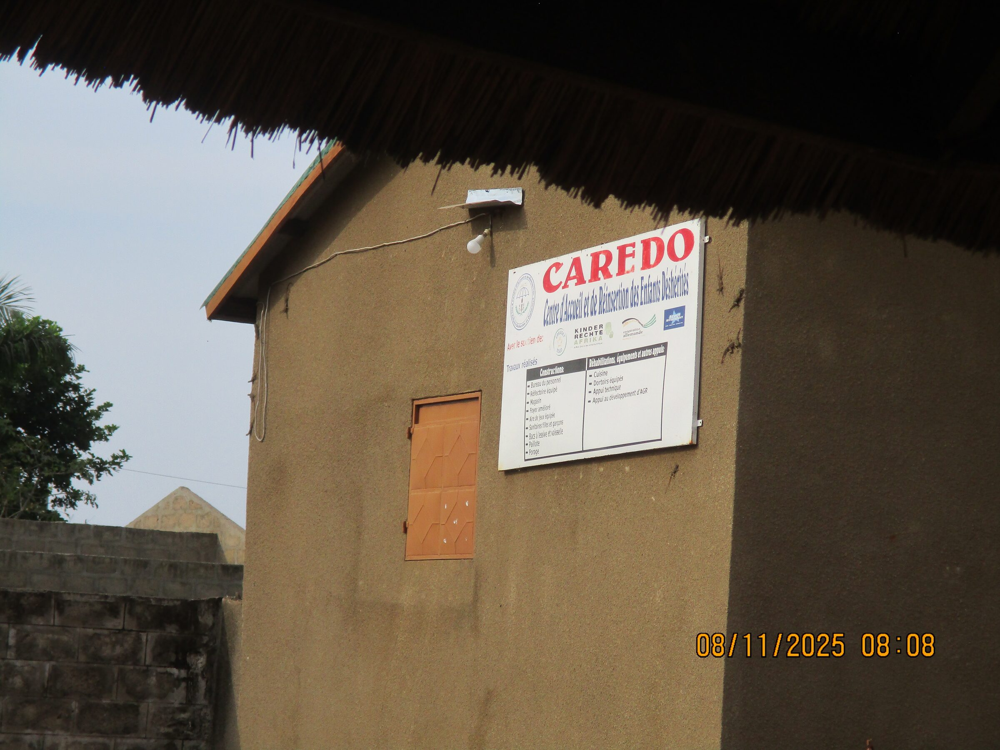
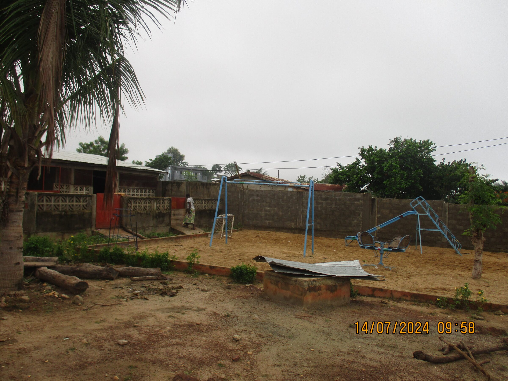

# Changement
Initialement gérée par l’ONG CAREDO, dont Mme Boukpessi est la directrice, cette institution accueille des enfants défavorisés et des orphelins. L’association Enfants-Kara fournit chaque mois à chaque enfant du centre un kit alimentaire. Elle répond également à des besoins ponctuels, comme l’achat de fournitures scolaires ou de vêtements, selon les demandes.

- <figure class="gallery-item">
  
  <figcaption>Centre Caredo</figcaption>
</figure>

- <figure class="gallery-item">
  
  <figcaption>Et sa place de jeux</figcaption>
</figure>
