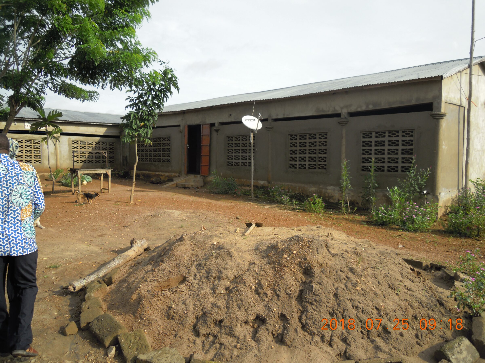
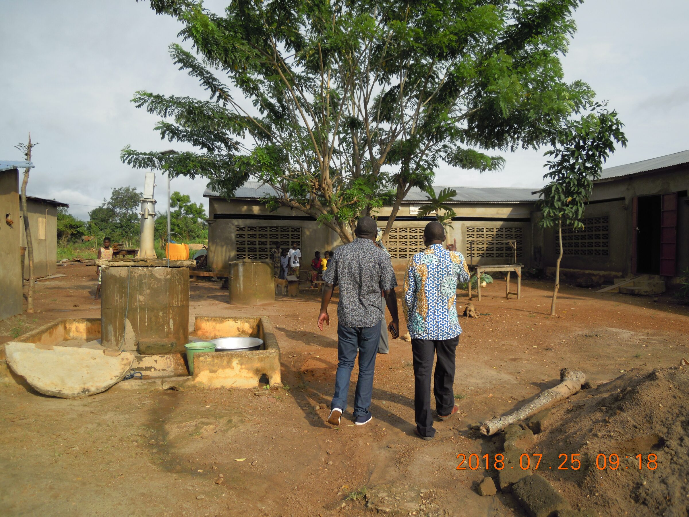
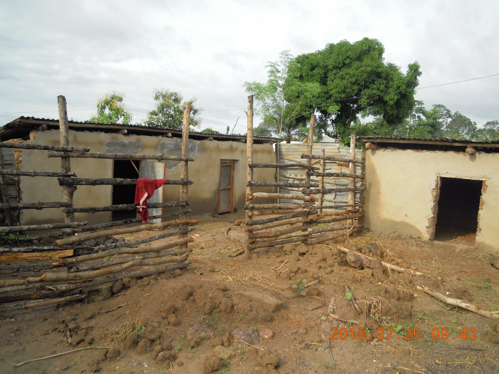
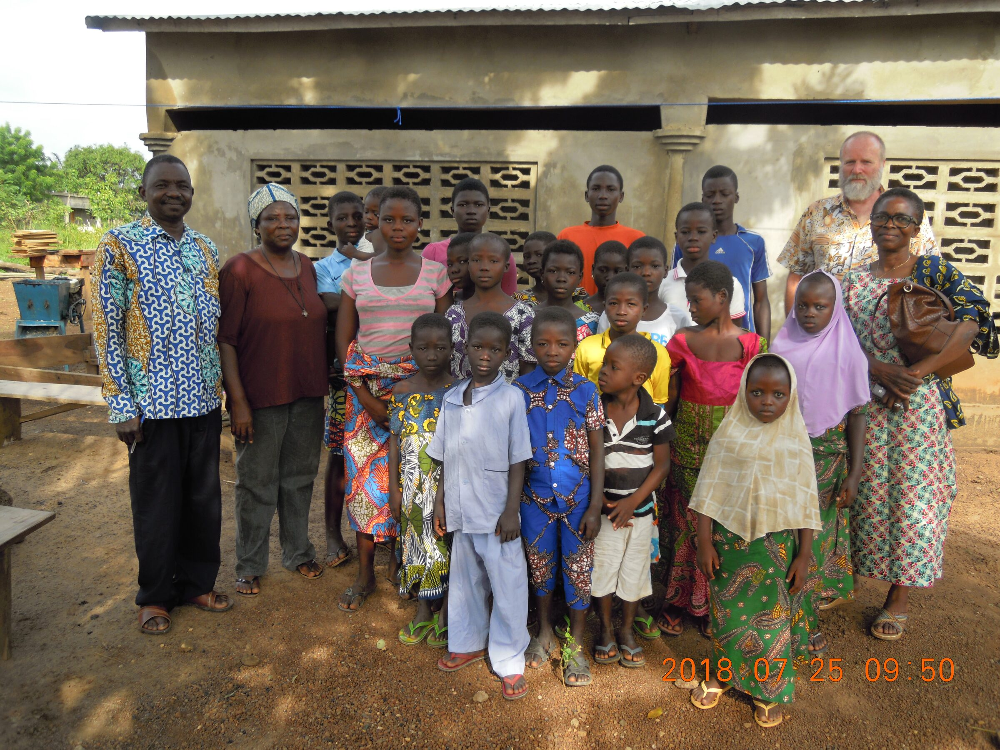

# Le foyer Caredo
L’orphelinat est visité une fois par mois par M. Kpéléé, le représentant salarié d’EKT, à l’occasion de la distribution des kits alimentaires. Sur place, il existe un élevage de porcs et de moutons.

Le centre a une cuisine, des dortoirs (filles et garçons), une salle commune, quatre cabines pour les toilettes et quatre cabines pour les douches. Il y a une fosse septique pour traiter les eaux usées. Il y a de l’électricité, de l’eau avec un puits et un forage avec un gros réservoir.

- <figure class="gallery-item">
   
   <figcaption>Vue d'une parte des bâtiments</figcaption>
  </figure>

- <figure class="gallery-item">
   
   <figcaption>Suite des bâtiments</figcaption>
  </figure>

- <figure class="gallery-item">
   
   <figcaption>Porcherie et étables</figcaption>
  </figure>

- <figure class="gallery-item">
   
   <figcaption>Photo de groupe</figcaption>
  </figure>

Enfants-Kara a également acquis deux terrains. Sur le premier, l’association plante des arbres fruitiers afin de compléter l’alimentation des enfants, ainsi que des palmiers à huile destinés à la fabrication de savon. Sur le second, elle construit une savonnerie. À terme, ce terrain permettra également de pratiquer le maraîchage.

