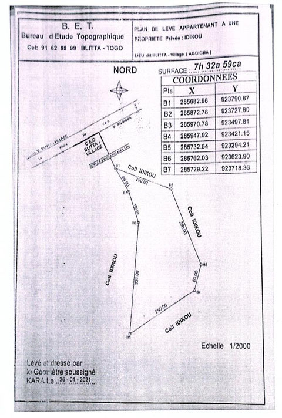

# Le foyer Caredo
L’orphelinat est visité une fois par mois par M. Kpéléé, le représentant salarié d’EKT, à l’occasion de la distribution des kits alimentaires. Sur place, il existe un élevage de porcs et de moutons.

Le centre a une cuisine, des dortoirs (filles et garçons), une salle commune, quatre cabines pour les toilettes et quatre cabines pour les douches. Il y a une fosse septique pour traiter les eaux usées. Il y a de l’électricité, de l’eau avec un puits et un forage avec un gros réservoir.

- <figure class="gallery-item">
  
  <figcaption>Vue d'une parte des bâtiments</figcaption>
</figure>

- <figure class="gallery-item">
  
  <figcaption>Suite des bâtiments</figcaption>
</figure>

- <figure class="gallery-item">
  
  <figcaption>Porcherie et étables</figcaption>
</figure>

- <figure class="gallery-item">
  
  <figcaption>Photo de groupe</figcaption>
</figure>

# Plan de l'ancien terrain

<figure class="gallery-item">
    
    <figcaption>Plan du terrain</figcaption>
  </figure>

## 1.2. Terrain

En annexe, vous trouverez la position par rapport à l’orphelinat de Caredo du terrain récemment acheté à Blitta, ainsi que les mensurations de celui-ci.

Blitta se trouve à environ 17 [km] de Tigbada et Sotouboua à 9 [km]. Blitta est une ville d’environ 55’000 habitants et Sotouboua une ville de 22’000 habitants.

C’est un immense terrain de 7 hectares, 32 ares et 59 centiares, ce qui fait 73’259 [m²]. Un terrain de football fait 6’400[m2], on a donc une surface de onze terrains de football. Il a été acheté à l’époque pour que Caredo puisse faire des cultures. Enfin, cette année (2024), on devrait terminer l’inscription de celui-ci au registre foncier, au nom de l’association EKT. Après presque quatre années de procédure, nous touchons au but. Ce n’est pas encore complètement terminé, mais ce n’est plus qu’une question de temps; les difficultés sont derrière nous.

Aujourd’hui, on trouve sur ce terrain du maïs, du sorgho, des arachides, qui occupent environ 200-300 [m²]. Il y a quelques arbres : 5 nérés, 6 karités et 2 manguiers.

· Le néré est connu sous le nom de Parkia biglobosa, également connu sous le nom de "néré africain" ou "dawadawa" dans certaines régions d'Afrique de l'Ouest. C'est un arbre tropical largement répandu en Afrique subsaharienne, apprécié pour ses fruits comestibles, ses graines riches en protéines et ses diverses utilisations dans l'alimentation et la médecine traditionnelle africaine. Il est utilisé comme arôme d’assaisonnement des repas obtenu après transformation de ses graines.

· Le karité est connu sous le nom de Vitellaria paradoxa. L'arbre à karité est précieux pour ses fruits, dont les graines produisent du beurre de karité, largement utilisé dans l'industrie cosmétique et alimentaire. Le fruit de l'arbre à karité ressemble à une petite prune verte. À l'intérieur du fruit, il y a une noix qui contient les graines riches en matières grasses. Ces graines sont utilisées pour produire du beurre de karité. On le trouve dans une variété de produits cosmétiques, tels que les crèmes hydratantes, les baumes à lèvres et les lotions pour le corps en raison de ses propriétés hydratantes et émollientes. L’arbre a aussi des utilisations traditionnelles étendues. Différentes parties de l'arbre sont utilisées à des fins médicinales, alimentaires et matérielles.

· Le manguier est connu sous le nom de Mongifera indica. C’est un arbre fruitier dont les mangues sont largement consommées fraîches, mais elles peuvent également être transformées en jus, en purée, en confitures, en chutneys et même en desserts. En plus de ses fruits délicieux, le bois du manguier est également utilisé dans la fabrication de meubles et d'objets artisanaux.

Ce terrain n’est pas équipé. Il n’y a pas d’eau, ni électricité. Il y a une rivière assez éloignée du terrain. Le manque d’eau est un problème pour la culture. Il n’y a pas de « route » d’accès, uniquement une piste. Actuellement, des bidons sont remplis d’eau et acheminés manuellement.

Au moment des cultures, les labours sont fait par des journaliers, payés 6 à 7’000 FCFA pour un labour de 50[m2] (1 CHF vaut environ 650 FCFA). Les enfants de Caredo font les récoltes.

# 2. Projets

Si on veut construire quelque chose sur ce terrain, il faut tout acheminer l’eau, le sable le ciment, les tôles, le bois et le ferraillage.

L’idée initiale ayant conduit à l’achat de ce terrain a été de rendre « durable » le foyer Caredo, l’autonomiser en lui apportant un outil lui permettant de compléter son quotidien avec des fruits, des légumes frais et de l’élevage. Il permettra aussi d’apporter un complément financier en faisant du maraîchage et de devenir un lieu où on pourrait faire de la formation dans l’agriculture bio.

## 2.1. A court terme

On va commencer par planter des arbres, car cela prend du temps pour pousser. On choisira par exemple des palmiers à huile, des orangers, des manguiers, des acajous, des cocotiers, des bananiers, des avocatiers et des papayers. Ils pousseront pendant que nous élaborerons les futurs projets d'extensions.

Chaque plant d’arbre doit être entouré d'une une protection en osier pour éviter qu’il se fasse manger par les chèvres (ou autres). Quand nous seront sur place, nous visiterons le site et nous discuterons avec EKT, Caredo et M. Kpéléé pour définir la stratégie.

## 2.2. A long terme

Améliorer le maraîchage en impliquant des femmes du coin, en les chargeant de cultiver et d’aller vendre les fruits et légumes. Cela impliquerait un doublement ou un triplement des surfaces cultivées. Sur place, on discutera sur la manière de faire.

## 2.3. A plus long terme

Plusieurs voies sont envisagées:

· Création d’un puits ou d’un forage pour l’arrosage. EK dispose du spécialiste en la matière et il pourrait (?) associer une autre association dont il fait partie.

· Faire venir de l’électricité ou monter des panneaux solaires.

· Construire quelques pièces pour loger Kpéléé, l’outillage ainsi que des animaux de ferme.

· Développer le maraîchage. Cultiver des carottes, du chou, des tomates du piment. La vente se ferait par des femmes revendeuses, qui achèteraient la marchandise le matin et la vendrait. Cette manière de faire éviterait de faire de la concurrence directe au marché, et nous évitera d’avoir à gérer une place au marché. A voir sur place quand nous serons au Togo.

· Formation et éducation d’apprentis en culture sur le terrain en faisant venir des professeurs spécialisés. Voir ce que peut proposer une école d'agriculture avec des enseignants venant du Benin.

Bien entendu, les choix se feront en collaboration étroite avec EKT sur le terrain cet été.

Pour 2024, EKS a mis dans le budget la somme de Frs 1’000.- pour l’achat de plants d’arbres, des paniers de protection et pour la plantation, les soins et la surveillance.

