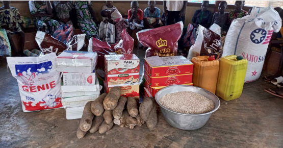
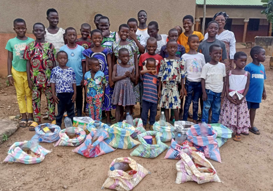

# Distribution nourriture
Chaque mois, Enfants-Kara achète des vivres pour la nourriture des enfants dans leurs foyers respectifs. Chaque mois, notre représentant sur place, M. Kpéléé assiste aux achats, à la répartition des vivres dans des cornets et à leur distribution. Chaque mois, EKS reçoit un rapport d'activités des foyers de l'Espérance, Ste-Marguerite et Caredo, avec les photos des vivres et des enfants avec leurs paquets. Par exemple, pour octobre 2026:

