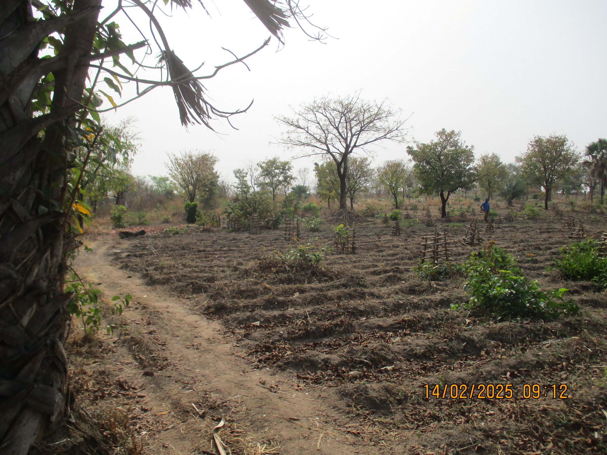
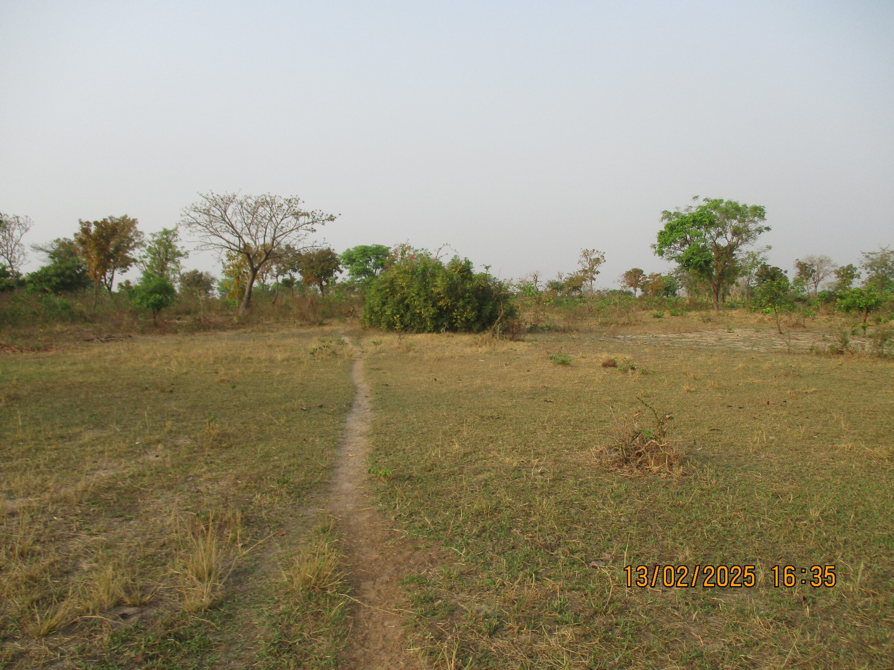

Enfants-Kara a également acquis deux terrains.
- Sur le premier, l’association plante des arbres fruitiers afin de compléter l’alimentation des enfants, ainsi que des palmiers à huile destinés à la fabrication de savon.
- Sur le second, l'association construit une savonnerie. À terme, ce terrain permettra également de pratiquer le maraîchage.

### Ancien terrain, maintenant nommé "verger"
Au mois d'avril 2004, après la création de l'ONG Enfants-Kara Togo, l'association fait l'acquisition d'un terrain situé à une dizaine de kilomètres du foyer Caredo.

Ce terrain est très caillouteux, peu propice à la culture. On va planter des arbres fruitiers comme complément alimentaire pour les enfants du foyer Caredo.
Par la suite ce terrain sera appelé "verger".
Pour plus d'information sur ce projet aller sur [projet verger](/projets-en-cours/Verger/).

### Terrain Yaloumbè
En 2025, Claude et Rose Balmer achètent un terrain à Yaloumbè afin d’en faire don à Enfants-Kara Togo. Ce terrain sera consacré au maraîchage et à la fabrication de savon. Des locaux y seront aménagés pour héberger M. Kpéléé et sa famille, entreposer les outils et stocker les récoltes avant leurs ventes.

Par la suite, le projet est complété par la construction d’une savonnerie.

Pour plus d'information sur ce projet aller sur [projet savonnerie](/projets-en-cours/Savonnerie/).
