Enfants-Kara mène, en partenariat avec le foyer Caredo, des actions de long terme. Chaque mois, l’association distribue à chaque enfant du foyer un kit alimentaire. Elle cherche également à développer d’autres sources de financement durables pour le foyer, notamment grâce au maraîchage et à la fabrication de savon.

Pour illustrer ces actions, nous pourrions publier chaque mois quelques photos, comme celles ci-dessous, montrant l’achat des denrées et la distribution des colis alimentaires aux enfants du foyer.

- <figure class="gallery-item">
    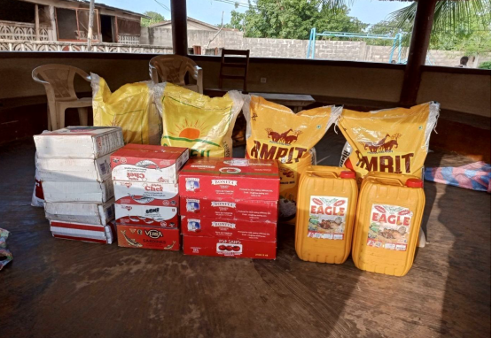
    <figcaption>Produits achetés pour les kits alimentaires</figcaption>
  </figure>
- <figure class="gallery-item">
    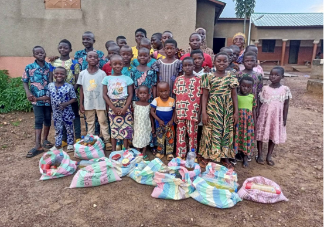
    <figcaption>Ensemble des enfants ayant reçu les kits alimentaires</figcaption>
  </figure>

# Foyer Caredo (juillet 2026)
L'année 2026 a permis la création de la savonnerie sur le terrain de Yaloumbé. Pour 

---

# Foyer Caredo (juillet 2025)

- <figure class="gallery-item">
    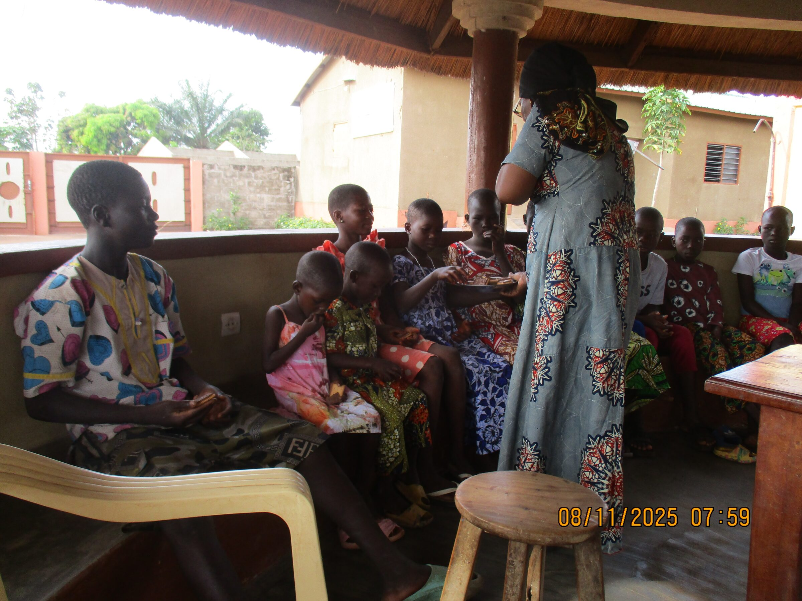
    <figcaption>Distribution de biscuits de Suisse</figcaption>
  </figure>
- <figure class="gallery-item">
    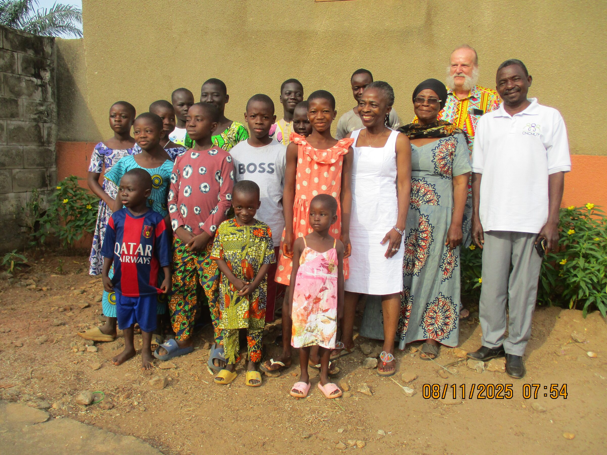
    <figcaption>Photo de famille avec les enfants du foyer</figcaption>
  </figure>

---
# Foyer Caredo (juillet 2024)
La visite de Rose, Déou et Claude Balmer au foyer Caredo sera également l’occasion de planter les arbres du futur verger.

- <figure class="gallery-item">
    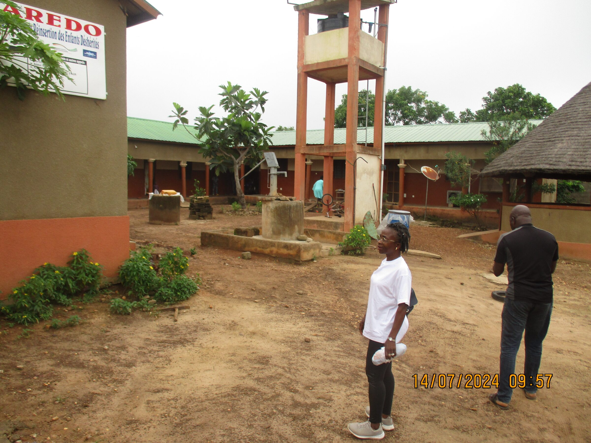
    <figcaption>Rose Balmer dans la cour du foyer</figcaption>
  </figure>
- <figure class="gallery-item">
    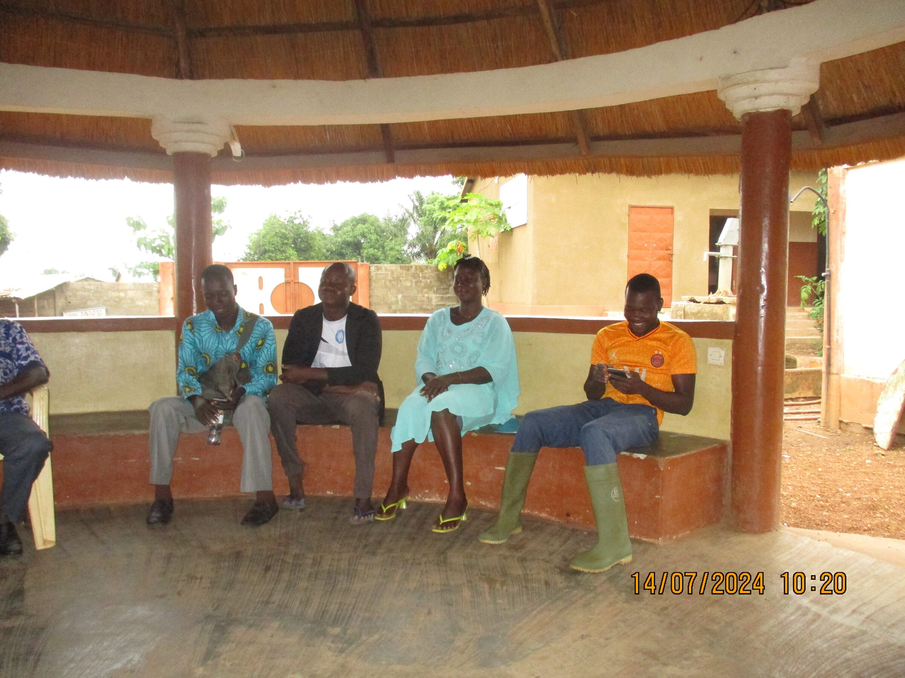
    <figcaption>Encadrement des enfants avec M. Kpéléé à droite</figcaption>
  </figure>

#
Il faut parcourir plusieurs kilomètres avant d’atteindre le terrain, le triporteur chargé de jeunes arbres destinés à donner vie au futur verger. Manguiers, palmiers à huile, orangers, pamplemoussiers et citronniers font partie des essences choisies.

Malgré la distance et les difficultés du trajet, chacun avance avec enthousiasme, en pensant déjà à voir ces arbres grandir et porter leurs fruits. La première étape prévoit la plantation de 150 arbres. Comme il faudra patienter quelque temps avant les premières récoltes, il a été décidé de commencer par le verger, avant d’entreprendre la construction de la future savonnerie.

- <figure class="gallery-item">
    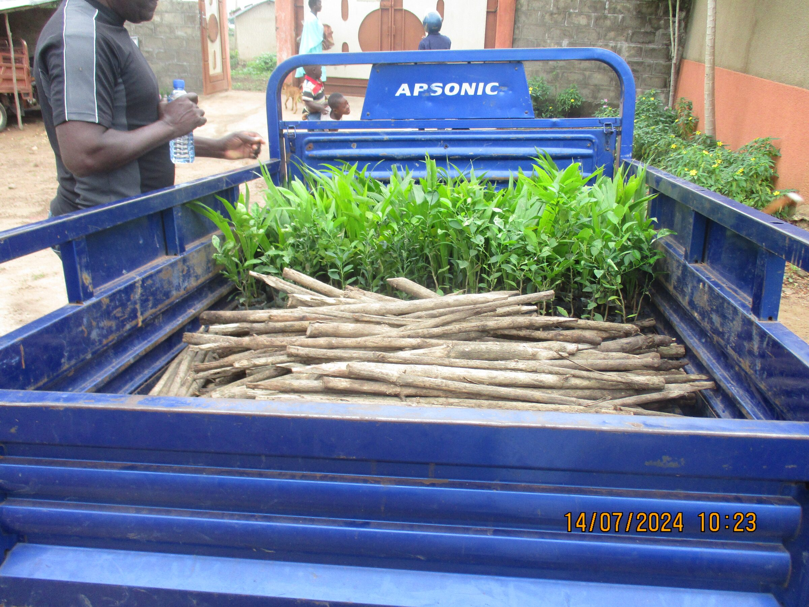
    <figcaption>Plantes prêtes pour le verger</figcaption>
  </figure>
- <figure class="gallery-item">
    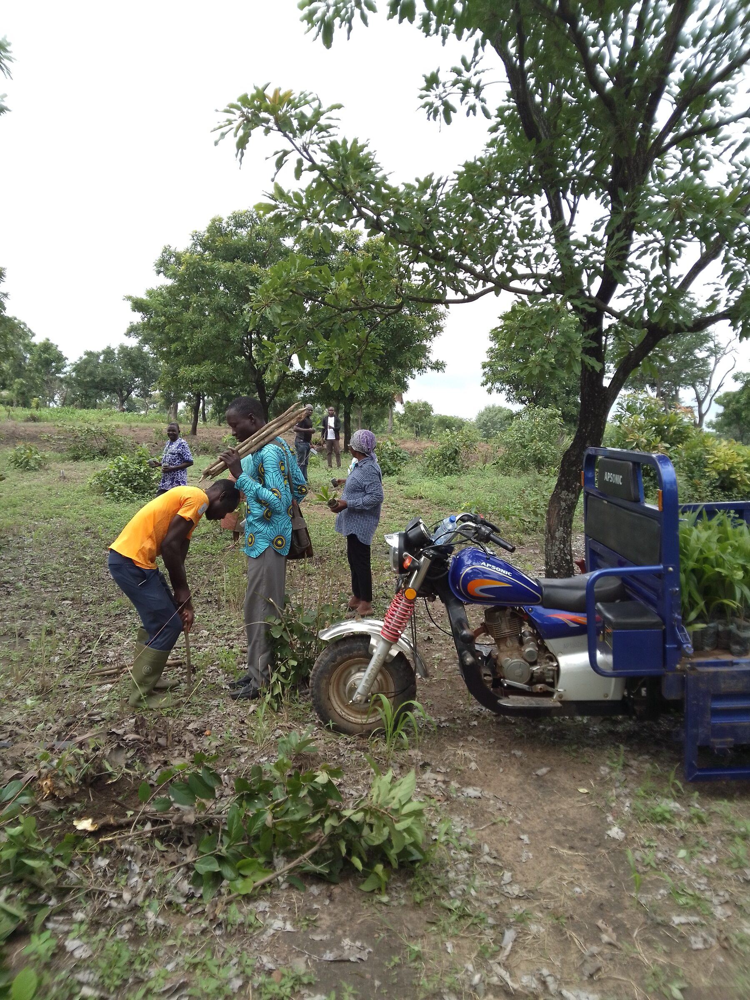
    <figcaption>Arrivée dans notre verger</figcaption>
  </figure>
- <figure class="gallery-item">
    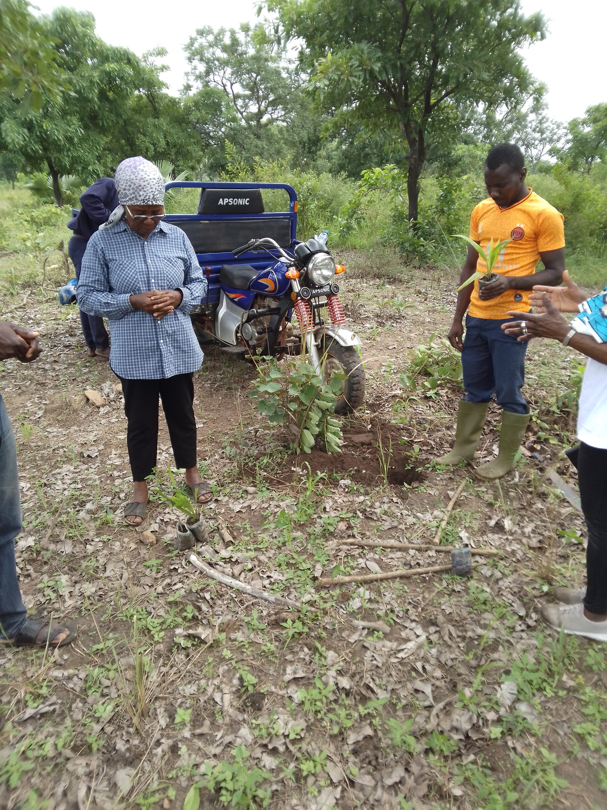
    <figcaption>Petite cérémonie avant la plantation</figcaption>
  </figure>
- <figure class="gallery-item">
    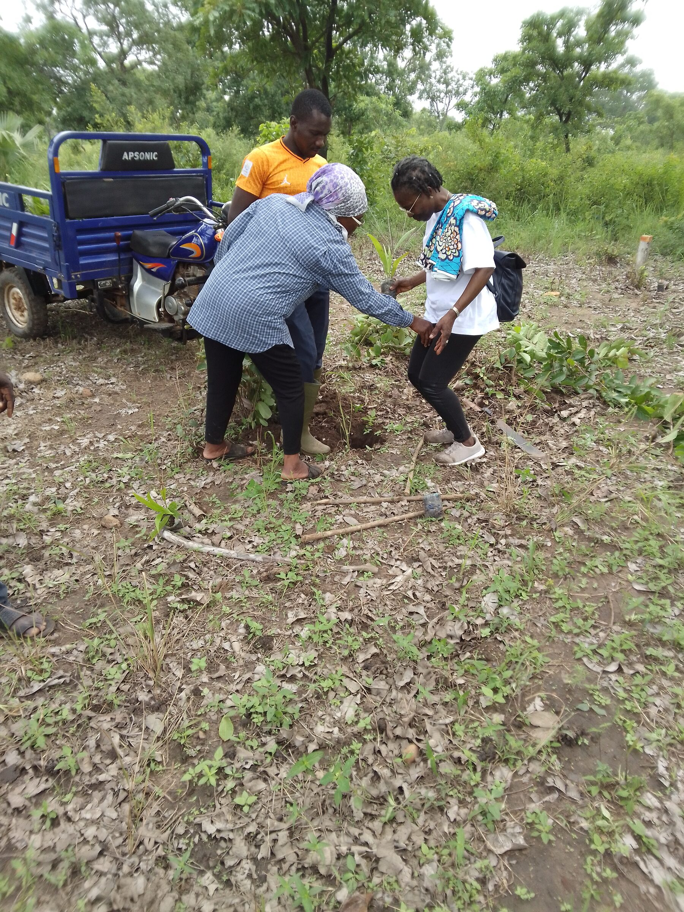
    <figcaption>Mise en terre du premier arbre</figcaption>
  </figure>

---
# Foyer Caredo (juillet 2021)

<figure class="gallery-item">
    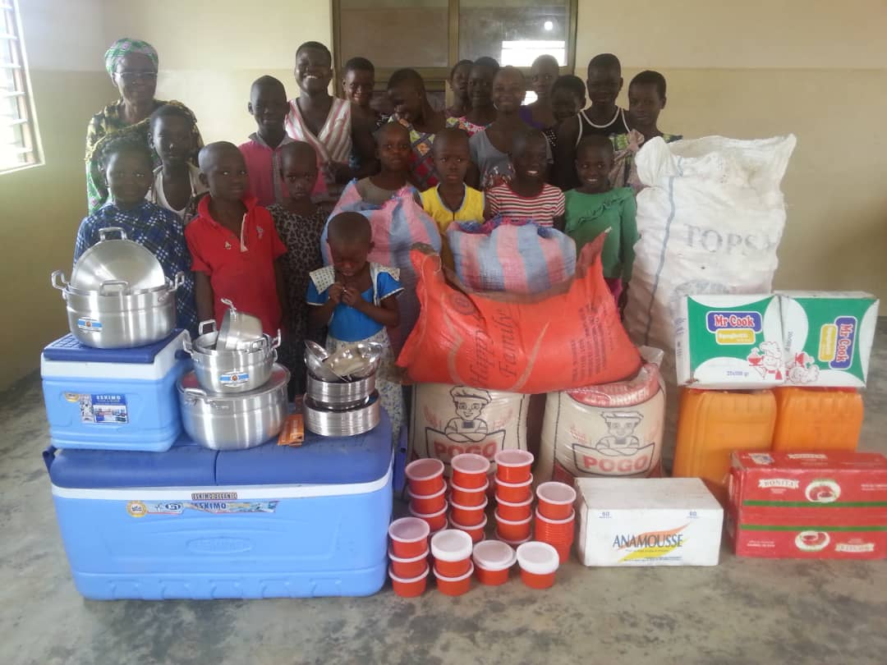
    <figcaption>Achats de vivres</figcaption>
  </figure>

---
