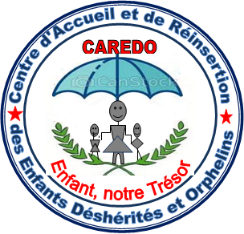
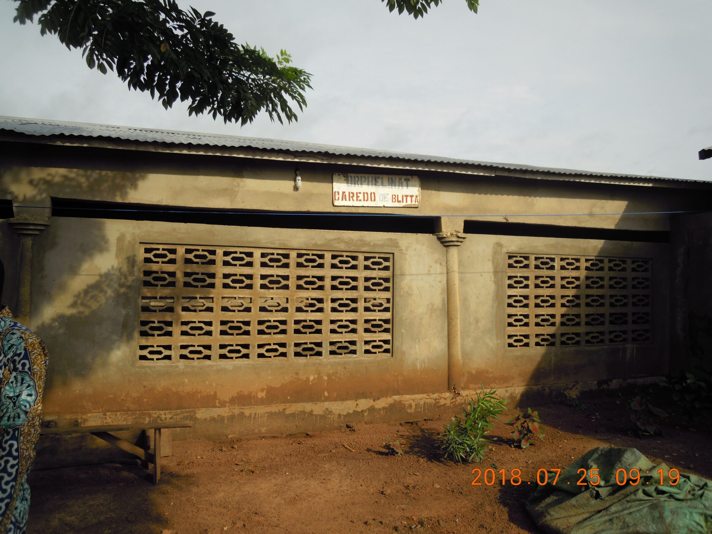
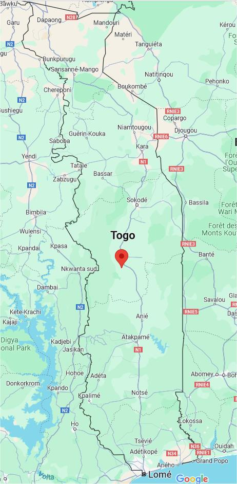
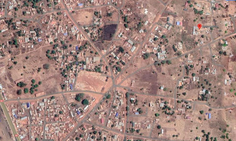

Consciente que l’aide aux autres organisations qu’elle soutient a permis à celles-ci d’atteindre une situation stable, l’association Enfants-Kara Suisse (EKS) s’est approchée du Foyer Caredo (**C**entre d’**A**ccueil et de **R**éinsertion des **E**nfants **D**esherités et **O**rphelins) . 
Claude et Rose Balmer l'ont visité pour la première fois au mois de juillet 2018 et ont commencé à établir un plan d’aide financière avec Mme Boukpessi, directrice, aide qui débutera en 2019.
Ce foyer héberge une quarantaine d’enfants orphelins ou défavorisés. Il est géré par Mme Koffi Assomtiba Gnanta depuis plusieurs années avec de petits moyens.

<figure class="gallery-item">
  
  <figcaption>Logo du Foyer Caredo</figcaption>
</figure>

Pour mener à bien ces actions, EKS a créé l’ONG Enfants-Kara Togo (EKT) le 1er août 2019. EKT est chargée de mettre en œuvre et de gérer sur place les projets initiés par EKS.

<figure class="gallery-item">
  
  <figcaption>Foyer Caredo en 2018</figcaption>
</figure>

Sur Google maps, chercher « caredo, togo » qui dirige automatiquement vers le foyer. Cela permet de le situer aux coordonnées Google : 8.34951, 1.01483.

Blitta est une petite ville située au centre du Togo sur la Nationale N1.
Blitta se trouve à environ 17 [km] de Tigbada et à 9 [km] de Sotouboua.
Blitta est une ville d’environ 55’000 habitants et Sotouboua une ville de 22’000 habitants.

<figure class="gallery-item">
    
    <figcaption>Situation géographique</figcaption>
  </figure>
Le point rouge donne sa position approximative dans le Togo.

# Vue aérienne de la ville de Blitta

<figure class="gallery-item">
    
    <figcaption>Plan de ville</figcaption>
  </figure>
L'orphelinat est situé vers le point rouge sur cette vue d'avion. La nationale 1 se trouve vers le coin bas à gauche.

