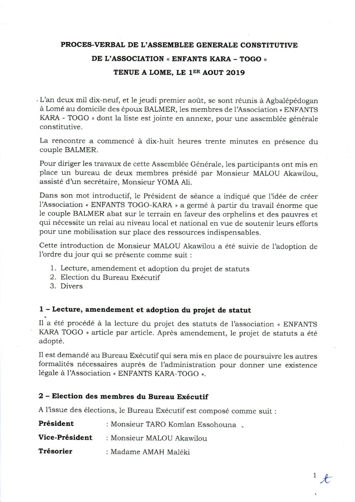
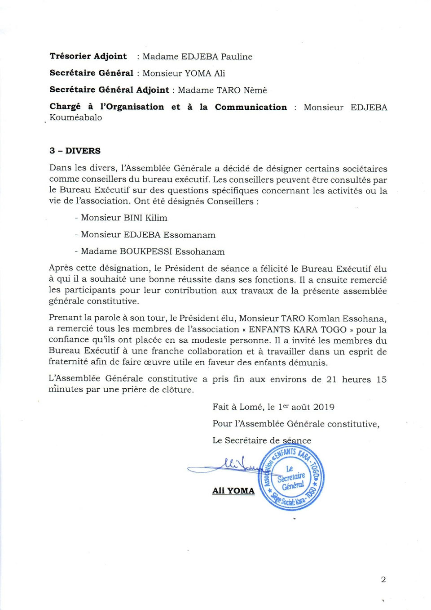

## Procès-verbal de l’Assemblée Générale Constitutive de l’association « Enfants Kara – Togo » tenue à Lomé, le 1er août 2019

- <figure class="gallery-item">
    
    <figcaption>Procès-verbal du 1er août 2019, page 1</figcaption>
  </figure>

- <figure class="gallery-item">
    
    <figcaption>Procès-verbal du 1er août 2019, page 2</figcaption>
  </figure>
