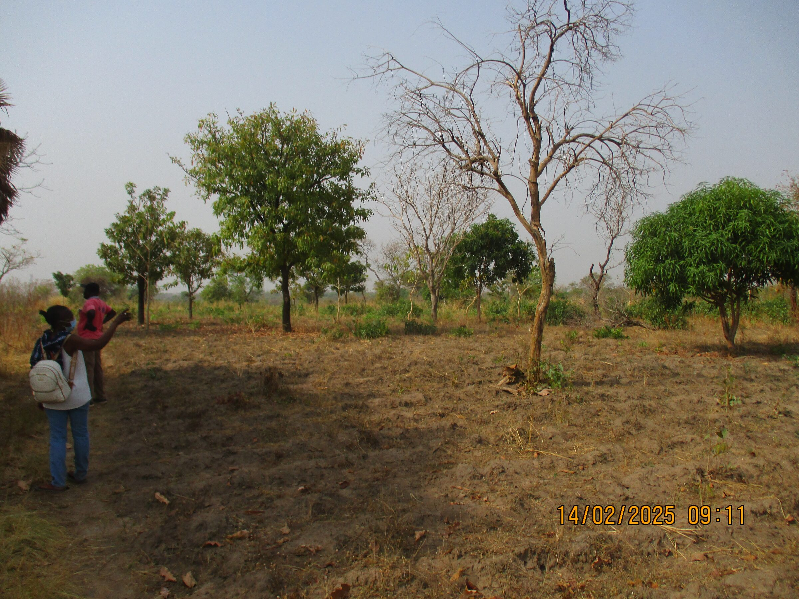
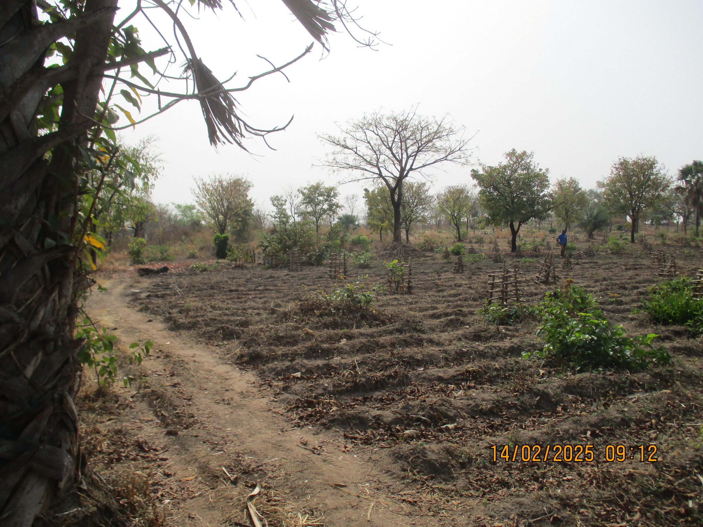
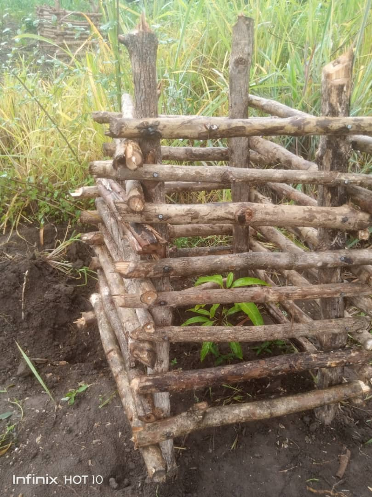
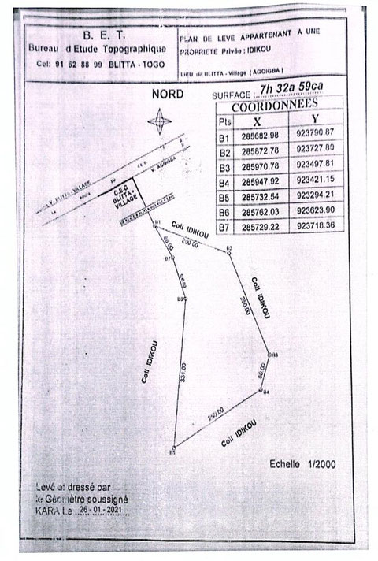

# Ancien terrain, maintenant nommé "verger"
Au mois d'avril 2004, après la création de l'ONG Enfants-Kara Togo, l'association fait l'acquisition d'un terrain situé à une dizaine de kilomètres du foyer Caredo. Par la suite ce terrain sera appelé "verger".

- <figure class="gallery-item">
   
   <figcaption>Terrain qui deviendra un verger</figcaption>
 </figure>

- <figure class="gallery-item">
   
   <figcaption>Les premiers arbres plantés dans leur protection</figcaption>
 </figure>

- <figure class="gallery-item">
   
   <figcaption>Gros plan sur la protection de la plante</figcaption>
 </figure>

# Plan de l'ancien terrain (depuis nommé verger)

<figure class="gallery-item">
    
    <figcaption>Plan du terrain</figcaption>
</figure>

C’est un immense terrain de 7 hectares, 32 ares et 59 centiares, ce qui fait 73’259 [m²]. Un terrain de football fait 6’400[m2], on a donc une surface de onze terrains de football. Il a été acheté à l’époque pour que Caredo puisse faire des cultures. Enfin, cette année (2024), on devrait terminer l’inscription de celui-ci au registre foncier, au nom de l’association EKT. Après presque quatre années de procédure, nous touchons au but. Ce n’est pas encore complètement terminé, mais ce n’est plus qu’une question de temps; les difficultés sont derrière nous.

Aujourd’hui, on trouve sur ce terrain du maïs, du sorgho, des arachides, qui occupent environ 200-300 [m²]. Au moment de l'achat, il y a quelques arbres : 5 nérés, 6 karités et 2 manguiers.

· Le néré est connu sous le nom de Parkia biglobosa, également connu sous le nom de "néré africain" ou "dawadawa" dans certaines régions d'Afrique de l'Ouest. C'est un arbre tropical largement répandu en Afrique subsaharienne, apprécié pour ses fruits comestibles, ses graines riches en protéines et ses diverses utilisations dans l'alimentation et la médecine traditionnelle africaine. Il est utilisé comme arôme d’assaisonnement des repas obtenu après transformation de ses graines.

· Le karité est connu sous le nom de Vitellaria paradoxa. L'arbre à karité est précieux pour ses fruits, dont les graines produisent du beurre de karité, largement utilisé dans l'industrie cosmétique et alimentaire. Le fruit de l'arbre à karité ressemble à une petite prune verte. À l'intérieur du fruit, il y a une noix qui contient les graines riches en matières grasses. Ces graines sont utilisées pour produire du beurre de karité. On le trouve dans une variété de produits cosmétiques, tels que les crèmes hydratantes, les baumes à lèvres et les lotions pour le corps en raison de ses propriétés hydratantes et émollientes. L’arbre a aussi des utilisations traditionnelles étendues. Différentes parties de l'arbre sont utilisées à des fins médicinales, alimentaires et matérielles.

· Le manguier est connu sous le nom de Mongifera indica. C’est un arbre fruitier dont les mangues sont largement consommées fraîches, mais elles peuvent également être transformées en jus, en purée, en confitures, en chutneys et même en desserts. En plus de ses fruits délicieux, le bois du manguier est également utilisé dans la fabrication de meubles et d'objets artisanaux.

Ce terrain n’est pas équipé. Il n’y a pas d’eau, ni électricité. Il y a une rivière assez éloignée du terrain. Le manque d’eau est un problème pour la culture. Il n’y a pas de « route » d’accès, uniquement une piste. Actuellement, des bidons sont remplis d’eau et acheminés manuellement.

Au moment des cultures, les labours sont fait par des journaliers, payés 6 à 7’000 FCFA pour un labour de 50[m2] (1 CHF vaut environ 700 FCFA). Les enfants de Caredo font les récoltes.

L’idée initiale ayant conduit à l’achat de ce terrain a été de rendre « durable » le foyer Caredo, l’autonomiser en lui apportant un outil lui permettant de compléter son quotidien avec des fruits, des légumes frais et de l’élevage. Il permettra aussi d’apporter un complément financier en faisant du maraîchage et de devenir un lieu où on pourrait faire de la formation dans l’agriculture bio.

## Projet

On va commencer par planter des arbres, car cela prend du temps pour pousser. On choisira par exemple des palmiers à huile, des orangers, des manguiers, des acajous, des cocotiers, des bananiers, des avocatiers et des papayers. Ils pousseront pendant que nous élaborerons les futurs projets d'extensions.

Chaque plant d’arbre doit être entouré d'une une protection en osier pour éviter qu’il se fasse manger par les chèvres (ou autres).

Pour 2024, EKS a mis dans le budget la somme de Frs 1’000.- pour l’achat de plants d’arbres, des paniers de protection et pour la plantation, les soins et la surveillance.

