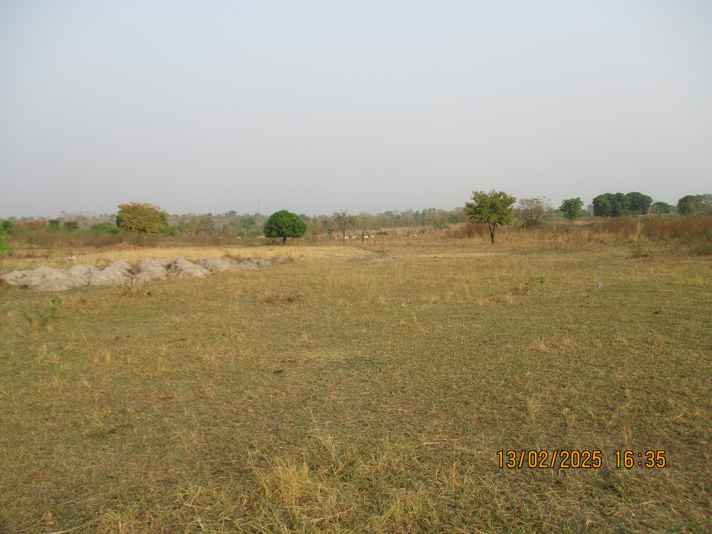
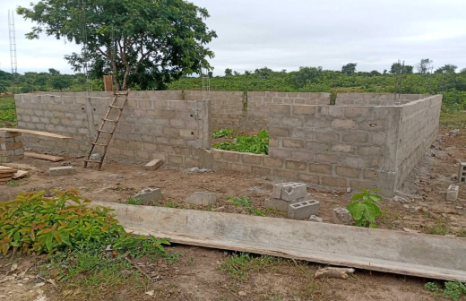
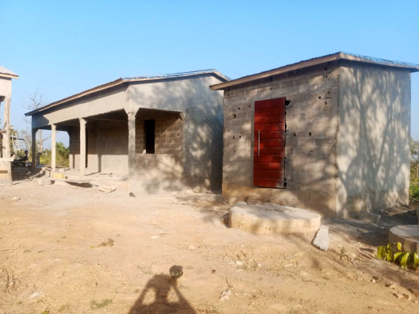
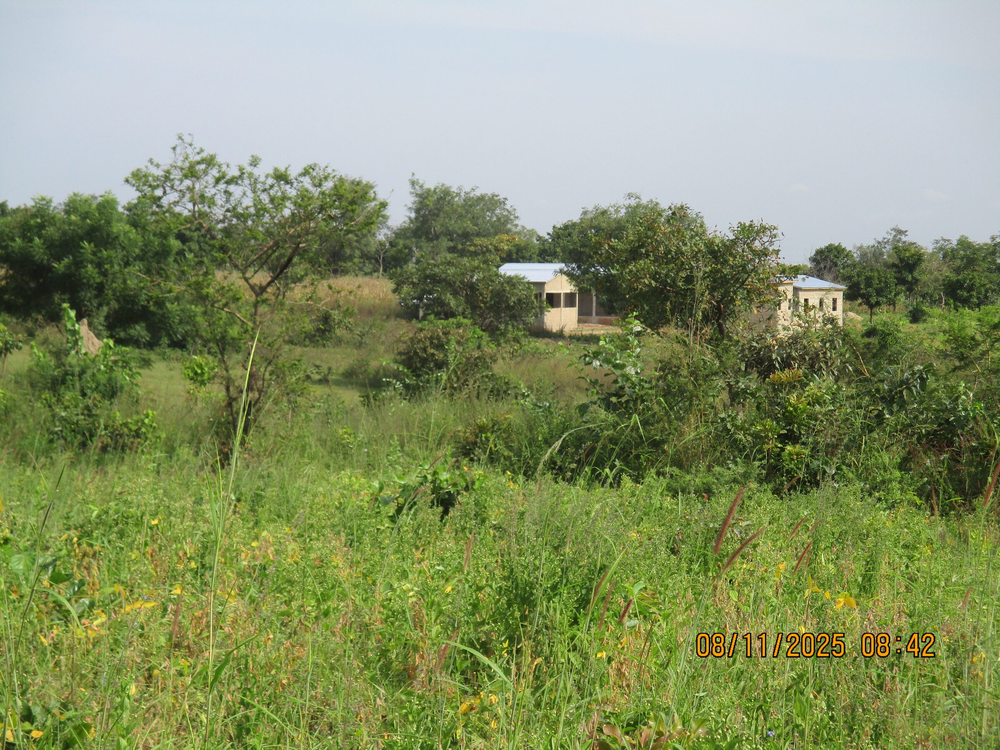

# Terrain Yaloumbè
En 2025, Claude et Rose Balmer achètent un terrain à Yaloumbè afin d’en faire don à Enfants-Kara Togo. Le terrain sera consacré au maraîchage. Des locaux y seront aménagés pour héberger M. Kpéléé et sa famille, entreposer les outils et stocker les récoltes avant leur vente.

Par la suite, le projet est complété par la construction d’une savonnerie.

- <figure class="gallery-item">
   
   <figcaption>Parcelle nue, venant d'être achetée</figcaption>
 </figure>

- <figure class="gallery-item">
   
   <figcaption>Début de la construction de l'apatam</figcaption>
 </figure>

- <figure class="gallery-item">
   
   <figcaption>Sanitaires commun et au fond: appartements</figcaption>
 </figure>

- <figure class="gallery-item">
   
   <figcaption>Cela ressemble à un petit village niché dans la brousse</figcaption>
 </figure>